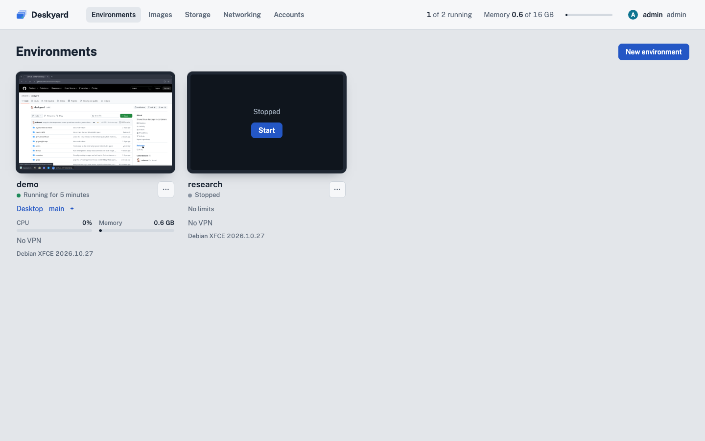
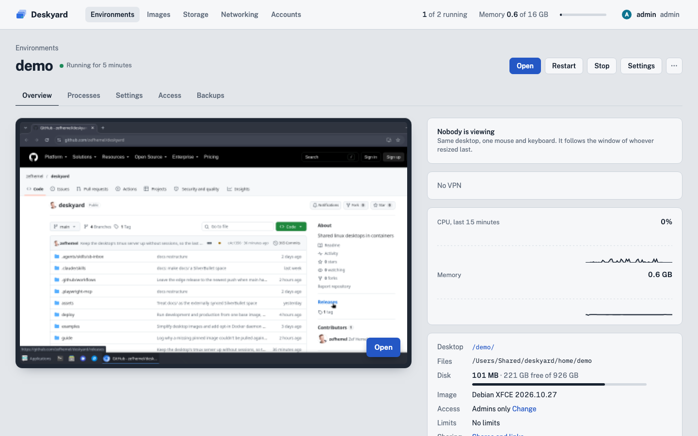

# Deskyard

Persistent Linux desktops you can access, share and control from anywhere—
in your browser or terminal. One app, the **supervisor**, runs them in containers.


The supervisor is one Go binary with its web UI built in. You sign in with
your own account and create, open, start, stop, upgrade and remove
**environments**. An environment is one persistent Linux desktop with its own
home folder, in the browser at `http://host/<name>/`; everyone with access to
it opens the same desktop, at the same time if they like. The fullscreen
button keeps the tab bar and current view together.

- **XFCE desktop in the browser**, streamed with
  [Selkies](https://github.com/selkies-project/selkies): picture, sound, your
  mic, gamepads, clipboard, file upload (including pasted screenshots), and touch controls on
  phones and tablets, with automatic stream quality, Retina scaling and a 1×/2× override.
- **Shared terminals** next to the desktop, with trackpad scrolling through
  history, finger swiping on phones, and touch keyboard helpers that stay hidden by default on desktops, joinable from the
  browser, desktop or your own terminal. Switch views with Ctrl+Shift+1–9; rename a session or detach without ending it from its tab’s dropdown.
- **One shared Chromium** whose tabs and sign-ins stay with the environment.
  It starts when you open it or connect through browser tools.
- **Sharing by link**: full access or observe-only, optionally for a limited
  time, revocable at any time.
- **Remote access and control** with the `deskyard` command: shells, files,
  screenshots, clicks and typing, port mapping and, for admins, managing the
  server.
- **Persistent installs**: `/workspace` is a plain folder on the host. Tools
  installed with mise, npm, uv or Flatpak survive restarts and image upgrades.
- **Volumes and backups**: folders shared between environments, and encrypted
  restic backups to S3, B2, SFTP or WebDAV storage.

The desktop image is Debian 13, `linux/arm64` and `linux/amd64`. About 0.4 GB
of RAM per running environment with Chromium open, so several fit on an 8 GB
machine.

<p>
  
  
</p>

## Run it

You need Docker (or OrbStack, or Docker Desktop) on Linux or macOS. The Docker
host needs `/dev/fuse` for desktop Flatpak file dialogs; see
[Images](guide/images.md#flatpak). The supervisor runs only in a container (`ghcr.io/zefhemel/deskyard`, amd64 and
arm64) and needs two things mounted: the Docker socket, and a folder of your
choice **at `/data`**, where it keeps everything. It finds that folder's path
on the host itself. Nothing else is needed: no `user:` or `group_add`, and no
hostname setting.

There are no versioned releases yet: images and binaries are built from `main`
on every change and tagged `latest` and
[edge](https://github.com/zefhemel/deskyard/releases/tag/edge).

### Production

With `docker run`:

```bash
docker run -d --name deskyard --restart unless-stopped \
  -v /var/run/docker.sock:/var/run/docker.sock \
  -v /srv/deskyard:/data \
  -p 127.0.0.1:7343:7343 \
  ghcr.io/zefhemel/deskyard:latest
```

Or with Compose, in a `compose.yaml`:

```yaml
services:
  supervisor:
    image: ghcr.io/zefhemel/deskyard:latest
    restart: unless-stopped
    volumes:
      - /var/run/docker.sock:/var/run/docker.sock
      - /srv/deskyard:/data
    ports:
      - "127.0.0.1:7343:7343"
```

and `docker compose up -d`. [`deploy/compose.yaml`](deploy/compose.yaml) is
the same with comments and the HTTPS options.

On first start the supervisor creates the account `admin` and prints its
generated password once in its log (`docker logs deskyard`, or
`docker compose logs supervisor`), unless you set `DESKYARD_ADMIN_PASSWORD`.
Open <http://localhost:7343>, sign in, and create an environment: name it
`alice` and its desktop opens at <http://localhost:7343/alice/>. The desktop
image is downloaded when you create the first one.

This listens only on the machine itself. For a server with a public domain,
set `DESKYARD_DOMAIN` and publish ports 80 and 443 instead: the supervisor
gets a certificate and serves HTTPS itself. For a LAN, Tailscale or your own
HTTPS proxy, see [Running Deskyard](guide/running.md).

### Development

From a checkout, in `supervisor/` (needs Go, Node 24 and Docker):

```bash
make dev
```

This cross-compiles the supervisor, builds the supervisor's base image once
and (re)starts a container from it with the binary mounted over the image's,
on <http://localhost:7343>, with the data folder `test-instance/` next to
`supervisor/`. Run it again after every edit: it takes a few seconds and needs
no image build. `DEV_DATA`, `DEV_PORT` and `DEV_NAME` choose another data
folder, port and container name, for a second instance. Compose users run
`make linux` and then `docker compose up -d --force-recreate` with
[`supervisor/compose.yaml`](supervisor/compose.yaml).

To build a desktop image from the checkout, run `docker buildx bake --load` in
the top folder; it is tagged `deskyard-debian-xfce:dev`, which you can add on
the **Images** page. Tests and the rest of the workflow:
[Development](guide/development.md).

## The `deskyard` command

Inside an environment it's already there, supplied by the supervisor at runtime
so CLI updates need no desktop image rebuild. On your own Linux or macOS machine:

```bash
curl -fsSL https://raw.githubusercontent.com/zefhemel/deskyard/main/install.sh | sh
deskyard login https://desktops.example.com/alice   # approve in your browser
deskyard -e alice shell
```

More: [The deskyard command](guide/cli.md).

## Configuration

Environment variables of the supervisor:

| Variable | Default | |
|---|---|---|
| `DESKYARD_LISTEN` | `0.0.0.0:7343` | address for plain HTTP inside the container |
| `DESKYARD_DOMAIN` | | serve HTTPS for this domain on 80/443, with an automatic certificate |
| `DESKYARD_ENGINE_HOST` | `DOCKER_HOST`, else the default socket | the engine to drive |
| `DESKYARD_SUBNET` | `10.213.0.0/16` | each environment's network gets a /28 from it |
| `DESKYARD_ADMIN_USER` | `admin` | first start only: the first admin |
| `DESKYARD_ADMIN_PASSWORD` | generated, printed once | first start only: its password |
| `DESKYARD_IMAGE` | `ghcr.io/zefhemel/deskyard-debian-xfce:latest` | the catalog's first image |

Back up the whole data folder (see
[the data folder](guide/storage.md#the-data-folder)); its `cache/` can be left out.

## Guides

- [Running Deskyard](guide/running.md): domains, LANs and plain HTTP, Tailscale, security.
- [Using the desktop](guide/desktop.md): display and touch controls, the iPhone Home Screen, shared terminals.
- [Environments](guide/environments.md): lifecycle, Docker access, outbound VPN, what persists, reclaiming memory.
- [Storage](guide/storage.md): volumes, WebDAV drives, backups and the data folder.
- [Images](guide/images.md): the catalog, pulling updates with progress, upgrades, custom images, Flatpak and AppImages.
- [Accounts and sharing](guide/sharing.md): accounts, access levels and share links.
- [The deskyard command](guide/cli.md): signing in, remote control, port mapping and agents.
- [Development](guide/development.md): building, testing, repository layout and project records.

The supervisor's HTTP API is described in [supervisor/API.md](supervisor/API.md).
