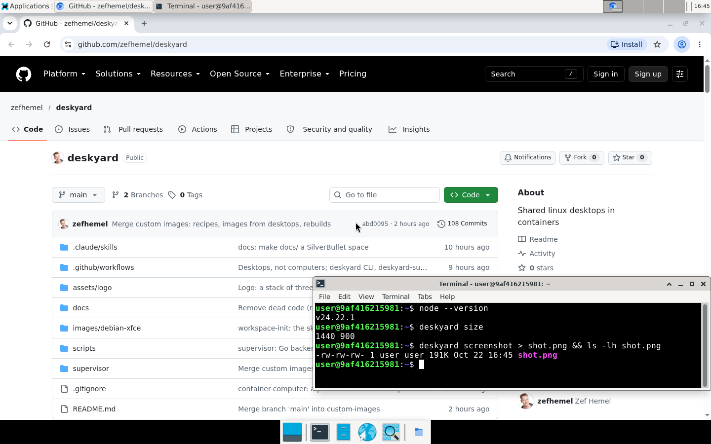

# Deskyard

Persistent Linux desktops you can access, share and control from anywhere—
in your browser or terminal. One app, the **supervisor**, runs them in containers.



The supervisor is one Go binary with its web UI built in. You sign in with
your own account and create, open, start, stop, restart, upgrade and remove
**desktops**, and see what each one is doing. Every desktop's desktop is
in the browser at `http://host/<name>/`, and everyone with access to it
opens the same desktop, at the same time if they like. Live UI updates and screen action marks use WebSockets, so multiple viewer tabs also work over plain HTTP without occupying the browser’s limited HTTP fetch connections.

What's in a desktop:

- **XFCE desktop in the browser**, streamed with
  [Selkies](https://github.com/selkies-project/selkies): picture, sound,
  your mic, gamepads, and your webcam where the host has a virtual camera.
  It resizes to fit your browser window (or keeps a locked size), and the
  bar above it has the clipboard, keys the browser would otherwise take
  (Ctrl+Alt+Del, Alt+Tab, ...), quality presets, sound and mic, and a
  Download button. Drop files on the screen to copy them onto the desktop.
  Badges show who has their mic or camera on. On phones and narrow tablets,
  Lock size, resolution presets, Keys, Quality and Download are in the scrollable More menu.
- **One shared Chromium** with one profile: your tabs and sign-ins stay
  with the desktop. It starts when you open it or connect through browser tools.
- **Remote access and control**: use the `deskyard` command from your terminal
  for shells, shared terminals, file transfers, screenshots, clicks and typing.
  Map ports to reach services on either machine.
- **Persistent installs**: `/workspace` (the user's home) is a plain folder
  on the host (`~/deskyard/<name>`). Tools installed with mise, npm, uv or
  Flatpak live there and survive restarts and image upgrades.
- **CLI activity**: see terminal clients and programs working on a desktop
  alongside browser viewers, with what they are running, recent actions,
  and marks on the screen where they click and type. Typed text and secrets
  on command lines are hidden.

The desktop image is Debian 13, `linux/arm64` and `linux/amd64`. About 0.4 GB
of RAM per running desktop with Chromium open, so several fit on an 8 GB
machine.

## Install on an iPhone Home Screen

In Safari, open Deskyard, sign in, then choose **Share → View More → Add to
Home Screen** (the exact share-sheet layout depends on iOS). Leave **Open
as Web App** enabled and tap **Add**. Launch the Deskyard icon to open the
app without Safari's address bar; choose a desktop from the wall.

The installed app supports portrait and landscape, keeps controls clear of
the Dynamic Island and home indicator, and resizes around the software
keyboard. On iOS, a solid strip below the status bar keeps the system's
top-edge blur away from toolbar text. It needs the running supervisor and
a network connection; remote desktop sessions are not cached for offline use.
Installation and native keyboard input were verified in the iOS 27 iPhone
simulator, including on the plain HTTP LAN demo. HTTPS is still required
for mic, camera and automatic clipboard synchronization; see Running on a LAN.

## Mobile application prototype

The desktop bar's **Apps** button lists running windows and installed applications.
Choose a window or launch an application to focus its region in the existing
stream. **Actual size** allows scrolling at one remote pixel per CSS pixel;
**Fit window** scales it to the available space. In Actual size, **Pan view**
lets you drag the picture; **Use window** returns touch input to the app. **Full desktop** returns to
the complete screen.

**Resolution ▾** beside **Lock size** chooses a remote screen size and locks it.
On phones, open **⋯ More** for **Resolution:** choices. Presets include
800×600, 1024×768, 1280×720, 1280×800, 1920×1080, and portrait sizes
600×900 and 900×1200. **Resolution: Auto fit** unlocks the size. The choice
is remembered in your browser; the first viewer controls the shared screen.
Return to **Full desktop** before changing resolution from a focused window.
More explains when another viewer controls the shared resolution.

Touch controls are available in both the full desktop and focused window,
including landscape phones and tablets:

- **Tap** clicks where your finger touches; **Trackpad** moves the pointer
  relative to your finger. In a magnified or Actual size view, moving the
  pointer to an edge pans your view to follow it. The choice is remembered
  in your browser.
- **Keyboard** shows or hides the phone's software keyboard. Esc, Tab,
  Enter and Paste are alongside it (swipe the extra keys if space is short).
- **Pinch** magnifies your own view, up to 4×. With the view magnified,
  move two fingers together to pan; **Fit screen** resets magnification.
  At fit, a two-finger swipe scrolls the remote application as usual.

Magnification is local: it does not zoom the application or resize the shared
remote screen. The controls remain outside the magnified picture. The page
follows the visible viewport when the software keyboard opens. These touch
controls are served by the supervisor and do not require rebuilding a
Selkies desktop image; the application launcher below does.

This experimental view requires a desktop image built from this branch
(`python3-gi`, `gir1.2-wnck-3.0`, and the `deskyard-apps` helper).
The crop is local to your browser; focus, pointer and keyboard remain shared.
The full screen is still transmitted. Windows are followed about once a
second, and known child dialogs are included; menus outside that region,
windows beyond the screen edges, minimum application sizes, and phone
keyboard behavior still need broader device testing. Use Full desktop when
needed. CLI action marks are hidden while focused.

## Install

There are no versioned releases yet. Everything below is **edge**: built
from `main` on every change, in the
[edge pre-release](https://github.com/zefhemel/deskyard/releases/tag/edge)
and the images' `latest` tags.

### The `deskyard` command

For access from your own terminal outside a desktop (inside one, it's already there).
On Linux or macOS:

```bash
curl -fsSL https://raw.githubusercontent.com/zefhemel/deskyard/main/install.sh | sh
```

It downloads `deskyard-<os>-<arch>` from the edge release, checks it
against `SHA256SUMS` and installs it to `~/.local/bin` (or, if that isn't
writable, to `/usr/local/bin` with sudo, saying so first). Set
`DESKYARD_VERSION` to install another release tag, and
`DESKYARD_INSTALL_DIR` to install elsewhere:

```bash
curl -fsSL https://raw.githubusercontent.com/zefhemel/deskyard/main/install.sh | DESKYARD_INSTALL_DIR=~/bin sh
```

On Windows, download `deskyard-windows-amd64.exe` (or `-arm64.exe`) from
the edge release.

### The supervisor

You need Docker (or OrbStack, or Docker Desktop) on Linux or macOS.

**The binary.** Download `deskyard-supervisor-<os>-<arch>` (`linux-amd64`,
`linux-arm64`, `darwin-amd64`, `darwin-arm64`) from the edge release and run
it:

```bash
curl -fsSLo deskyard-supervisor https://github.com/zefhemel/deskyard/releases/download/edge/deskyard-supervisor-linux-amd64
chmod +x deskyard-supervisor
./deskyard-supervisor
```

It finds the engine at `DESKYARD_ENGINE_HOST`, else `DOCKER_HOST`, else
the platform's default socket, keeps everything in `~/deskyard` (set
`DESKYARD_DATA_DIR` for another folder) and listens on `127.0.0.1:8080`. Its
user must be able to use the Docker socket. More settings: Configuration.

**In a container.** The image `ghcr.io/zefhemel/deskyard` (amd64 and arm64)
needs the Docker socket and the data folder, mounted **at the same path** as
on the host (see Storage):

```bash
docker run -d --name deskyard --restart unless-stopped \
  -v /var/run/docker.sock:/var/run/docker.sock \
  -v /srv/deskyard:/srv/deskyard -e DESKYARD_DATA_DIR=/srv/deskyard \
  -p 127.0.0.1:8080:8080 \
  ghcr.io/zefhemel/deskyard:latest
```

Or, from a checkout, `supervisor/compose.yaml` does the same:

```bash
cd supervisor
DESKYARD_DATA_DIR=/srv/deskyard docker compose up -d
```

### Desktop images

Nothing to install: the supervisor pulls
`ghcr.io/zefhemel/deskyard-debian-xfce:latest` when you create the first
desktop (see Images and upgrades).

## First start

On first start the supervisor creates the account `admin` and
prints its generated password once in its log (`docker logs deskyard`, or
`docker compose logs supervisor`, in a container), unless you set
`DESKYARD_ADMIN_PASSWORD`.
Open <http://localhost:8080>, sign in, and create a desktop: give it a name
like `alice` and its desktop opens at <http://localhost:8080/alice/>.

**On a server with a domain.** Set `DESKYARD_DOMAIN=desktops.example.com`,
point its DNS at the host and let ports 80 and 443 through: the supervisor
gets a certificate itself and serves HTTPS. In a container, publish `80:80`
and `443:443` instead of `127.0.0.1:8080:8080` (the compose file shows
where). Run directly on Linux, let the binary bind low ports with
`sudo setcap cap_net_bind_service=+ep ./deskyard-supervisor`. Without a domain, keep
the default localhost binding and put your own HTTPS proxy or Tailscale in
front.

### On a LAN

To reach Deskyard from other machines at home or in an office, either
serve it over https or accept what plain http costs.

**Plain http** (`DESKYARD_LISTEN=0.0.0.0:8080`, then
`http://192.168.1.20:8080`): browsers treat any address but `localhost`
over http as insecure and turn features off. The desktop page says so in
its bar ("Not secure: some features off"). What still works: the picture,
keyboard and mouse, sound, the Clipboard button's text box (both ways),
Lock size, Quality, upload, download and the CLI activity overlay. Gamepads
should too in Chromium and Safari, which keep the Gamepad API over http. What doesn't:

- **Mic and camera**: the browser has no `getUserMedia`. The Audio panel
  shows them off, with "Needs https".
- **Automatic clipboard sync**: copy and paste go through the Clipboard
  button instead.
- **H.264 in Chrome and Firefox**: without WebCodecs the picture is JPEG.
  At 1920x1080 and the Medium preset that is about 40 Mbit/s while a
  terminal scrolls (H.264: about 6), and next to nothing on a still
  screen. Fine on wired gigabit, workable on good Wi-Fi with Low (about
  18 Mbit/s); not for the internet. When one viewer is on JPEG the whole
  desktop streams JPEG, also to viewers on https.
- **Passwords travel in clear text.** Only on a network you trust.

**https** keeps everything. Without a public domain, the simplest is
Tailscale: run the supervisor on its default `127.0.0.1:8080`, then
`tailscale serve --bg 8080` on the same machine, and open
`https://<machine>.<tailnet>.ts.net` from any device on your tailnet. Or
put any reverse proxy with a certificate in front (Caddy:
`reverse_proxy 127.0.0.1:8080`); it must pass WebSockets through and keep
the `Host` header. With a public domain, `DESKYARD_DOMAIN` does it
itself (above).

## Shared terminal

On a phone, the streamed desktop’s **More → Terminal** action opens the terminal page; the desktop wall also has a direct **Terminal** link. Wider desktop toolbars keep the direct Terminal shortcut.

See the [create/join walkthrough and verification record](docs/Testing/Shared%20terminal%202026-10-23.md) for screenshots, native keyboard evidence and known limits.

Choose **Terminal** beside **Desktop**, or open `http://host/alice/terminal/`, to join the shared shell from the browser using your current login. The **Sessions** picker lists running named shells, including detached shells with live jobs, and marks the current shell. Choose a name to join it, or enter a new name and choose **Create** for another shell. The list refreshes while open; `?session=build-2` opens a shell directly. The page reconnects after brief network interruptions without replaying disconnected input; a closed shell has an explicit **Reopen terminal** action. Restarting a desktop ends its shells and jobs.

On phones, tap **Keyboard** to open the software keyboard. The scrollable key bar provides Ctrl+C/D/L, Esc, Tab, arrows, Home/End, PgUp/PgDn and Delete, plus one-shot Ctrl and Alt. Helper taps keep the keyboard open; paste and composition clear modifiers. Short keyboard viewports use a horizontally scrollable row for controls and session actions. If the browser leaves less than the minimum space for a readable terminal row and 44px controls, the page asks you to rotate to portrait or dismiss the keyboard; the shell stays connected. **History** opens tmux history: use PgUp/PgDn, then Esc to return. The font stays readable when clients have different sizes; a passive smaller client may show a cropped tmux view until it interacts.

`deskyard -d alice terminal` joins the desktop's shared Bash login shell in `/workspace`; `deskyard terminal build-2` selects another named shell. Inside the desktop, ordinary terminal windows and tabs (including **Deskyard Terminal**, the default terminal shortcut and file-manager terminal actions) each open a new shared shell named `terminal-1`, `terminal-2`, and so on, preserving their starting directory. The window/tab title shows the session name. The browser picker joins that exact shell. Within a native shared terminal, press **Ctrl-B then s** and choose its name; outside tmux, `deskyard terminal NAME` joins it. Browser clients use **Sessions** to switch; remote CLI clients detach and reconnect with the chosen name. Saved emulator defaults migrate at desktop startup; explicit emulator command launches such as `xfce4-terminal -x PROGRAM` still run the requested program directly. Run `deskyard terminal` locally to join `main`. Session names contain 1–64 letters, digits, underscores or dashes and start with a letter or digit. Detach with Ctrl-B then D; reconnecting joins the same shell and running jobs. Sessions end when the desktop stops or restarts. Existing desktops need an updated image with tmux and the shared terminal helper.

## Desktops

Admins create desktops with a name, an image from the catalog, and
optionally a memory and CPU limit (by default a desktop may use all of the
host's). Names are lowercase letters, digits and dashes, start with a letter
and can't be changed later. Each desktop is a container `deskyard-<name>` on its
own network `deskyard-<name>`, so desktops can't reach each other.

### Docker daemon access

**Docker daemon access** is an administrator checkbox when creating a desktop
or editing its Settings. It defaults off. Enable it on a desktop image with
the Docker CLI, such as the standalone [Docker example](examples/docker/README.md).
The supervisor checks and mounts the engine host's `/var/run/docker.sock`;
an updated desktop image gives `user` its socket group. Saving a changed
setting recreates the desktop, preserving its workspace.

Everyone using that desktop can then control the shared Docker daemon and
its containers, with host administrator privileges. Only enable this for
trusted users. This is separate from directory-only host folder mounts;
custom/rootless daemon socket locations are not currently supported.

### Outbound VPN

Administrators can add named connections on **VPN connections** (`/_vpn`), choose a country and enter [NordVPN service credentials](https://support.nordvpn.com/hc/en-us/articles/19685514639633-How-to-find-your-service-credentials-for-manual-NordVPN-setup), which differ from the account login. **Test connection** checks a candidate without changing desktops; blank credentials on an edit retain their saved values. Choose a saved connection or **No VPN** when creating a desktop or on its Settings tab. The same operations are available through the [VPN API](supervisor/API.md#vpn-connections-admin). Each selected desktop gets its own managed Gluetun gateway. Internet access stays blocked while the tunnel is unavailable; only an explicit selection of no VPN restores direct networking. Enabling, disabling or changing VPN settings recreates the desktop while preserving its identity and workspace. Saving settings warns about session disconnection and uses **Save and restart** for running desktops; files remain intact.

VPN desktop containers do not restart independently after an engine reboot: run the supervisor to recover their namespace and firewall before starting them. While the supervisor runs, background recovery restores the recorded power state after an unexpected desktop exit or a failed stop, retaining a healthy unchanged gateway. Interrupted settings changes, including an explicit No VPN selection, stay visible with a safe diagnostic and are retried; direct access returns only after that selected transition completes. Stopping a desktop keeps its gateway idle and may continue consuming a provider connection. LAN access is denied except for administrator-configured destination, transport and port rules. Existing agent port forwarding remains available; this feature does not prevent deliberate proxies or tunnels through permitted applications.

Shared connection edits list the affected desktops and require confirmation before validating and applying a new revision. Validation can be cancelled before commit; a failed validation keeps the saved revision. Each desktop rollout reports its own result and retains its selected policy on failure. Connections still used by a desktop cannot be deleted. Users with desktop access see separate VPN health, current exit IP only while connected, historical observations and idle status; only administrators change the configuration.

The OrbStack verification uses real Selkies desktops, the supervisor proxy, agent exec/files/activity and shared Chromium with two independent controlled WireGuard tunnels. It covers direct and containerized supervisors, blocked requests during tunnel loss, local access and recovery. Controlled WireGuard does not validate NordVPN service authentication. Live NordVPN service authentication, verified desktop egress and visible MATE desktop access were confirmed on OrbStack on 24 October 2026. Country/credential changes, provider limits, native Linux and a full engine/host reboot remain release checks; see the [verification guide](supervisor/tests/VPN.md) for the exact scope and outstanding observations.

Each enabled desktop adds one long-lived gateway container with its own CPU/memory use and provider connection; stopping the desktop does not release that cost. Desktop resource limits apply to the desktop, not its gateway. Version one uses public DNS through the tunnel, blocks external IPv6 and Docker's embedded resolver, and has no custom DNS selector. LAN exceptions intentionally send only their configured private IPv4 destination, TCP/UDP and ports outside the tunnel; other desktop/control networks and link-local destinations cannot be excepted.

### What persists

A desktop's private persistent folder is `/workspace`: the folder
`<data folder>/<name>` on the host, which you can browse and back up with host tools. Creating a desktop
with the name of a folder that already exists reuses that folder, so to copy
a desktop, copy its folder and create a desktop with the new name.
Removing a desktop keeps its folder unless you tick "also delete files".

| Need | Command |
|---|---|
| Runtimes and CLI tools | `mise use -g node@22 python@3.12 go jq ripgrep` |
| npm CLIs | `npm i -g <pkg>` |
| Python CLIs | `uv tool install <pkg>` |
| Desktop apps | `flatpak install --user flathub <app-id>` |
| Anything else | put binaries in `~/.local/bin` |

These all land in `/workspace` and are on `PATH`. Node and Python come
preinstalled with the image (outside `/workspace`, so they update with it);
`mise use` wins over them. There's no `sudo`, and anything installed with
`apt` or changed outside `/workspace` is lost when the image is updated.

uv defaults to its own Python installations in `/workspace` so installed
tools do not depend on the image's Python. This default comes from
`/etc/uv/uv.toml`; explicit uv flags and user configuration can override it.
Choosing the image's Python explicitly makes that environment dependent on
the image version.

### Desktop state across restarts

When a desktop stops (stop, restart, upgrades), its native session manager
logs out and saves the session; Chromium saves its tabs independently.
Native session restoration applies to applications that support that
desktop's session protocol. XFCE uses Settings > Session and Startup;
KDE Plasma and MATE use their own session settings. Most Electron and
Flatpak apps do not restore their windows through this protocol.

Switching desktop images keeps your files, installed Flatpak apps, tools
and Chromium profile. Each desktop keeps its own settings; open windows
are not migrated between different desktop environments.

### Host folders

Admins can mount existing host folders into an individual desktop under
**Settings → Host folders**. Choose **Add host folder**, enter the absolute
host path and a desktop path such as `/mnt/photos`, and choose read-only
or read-write access. New entries default to read-only. **Save and restart**
recreates a running desktop's container; a stopped desktop stays stopped.

Source paths refer to the machine running the container engine. They work
with the supervisor running directly or in a container; the supervisor
container does not need those folders mounted into itself. On macOS, the
container runtime must permit sharing the source folder. Existing host
permissions must allow the desktop's UID 1000 to access its files; Deskyard
does not change ownership or permissions of mounted host folders.

A desktop can mount up to 16 folders at non-overlapping paths below `/mnt/`.
Home and system paths are reserved so desktop initialization cannot change
mounted host data or replace its runtime. Missing sources and files are
rejected before the desktop stops; missing folders are never created.
Source validation requires Docker API 1.44 or newer and recursively read-only
bind mounts (Linux kernel 5.12 or newer, including the kernel inside a Mac
container runtime). An
engine that cannot enforce this fails the check before the desktop stops.
Desktops with host folders also disable privilege gains through setuid
executables and file capabilities; user-namespace sandboxes remain available.
Everyone with access to the desktop, including remote CLI clients, gets its mounted
folders. Settings and mounts survive restarts and image upgrades.

Removing a mount never deletes its source. Removing a desktop only deletes
its private workspace when requested; independently mounted folders elsewhere
are left alone. Mounted host folders are not included when making an image
from a desktop. The supervisor's Files and Download views still browse only
`/workspace`; use desktop apps or the CLI for mounted folders.

### Reclaiming memory

Admins can click **Reclaim memory** on a running desktop's details page to
ask the host to release idle memory while its apps keep running. The result
shows resident memory before and after; this includes file cache, and swapped
pages may still use compressed RAM. Savings vary and apps may briefly respond
more slowly when accessed again.

On supported hosts, each desktop also gets one automatic 128 MiB reclaim
attempt after 15 minutes with no viewers. A returning viewer resets the timer,
even if they leave again between checks. Active CLI clients, desktop operations,
and missing or stale activity reports delay reclamation without consuming the
attempt. Failed attempts are not retried during that absence. Checks run every
30 seconds and requests run one at a time. Supervisor/container restarts start
a fresh timer. Admins can turn off **Automatically reclaim idle memory** in a
desktop's Settings; this saves immediately without a restart and survives
container recreation. The manual button remains available.

Automatic reclamation requires the desktop's activity service to send current
command-status heartbeats. Older desktop binaries with only blank heartbeats
keep running normally but skip automatic reclamation; update the desktop image
to use it. Activity detection covers operations recorded by Deskyard, not plain
shell commands or other unreported background work; use the opt-out for those.

This requires a rootful Linux Docker engine with cgroup v2 and swap available
to the desktop. It works through the Docker socket, including with the
supervisor running on macOS against OrbStack. The supervisor pulls a small
Alpine helper image if needed and removes its temporary helper containers
after each request. At boot it checks the engine's memory/swap controls and
tests the full helper path, including `memory.reclaim` with swappiness, on a
tiny disposable container. The log reports whether reclamation is enabled
and why it is disabled if a check fails. A failed check leaves the rest of
the supervisor running and disables the button with a reason. Restart the
supervisor after fixing host support to run the check again. Each request
still checks the selected desktop's swap settings; a failure there does not
disable reclamation for other desktops. No memory limits or host swap
configuration change.

### Images and upgrades

The **Images** page holds the catalog of images desktops can be created
from. XFCE, KDE Plasma and MATE are built-in choices, visible before download.
They share one Debian runtime; XFCE remains the default on first start:


| Desktop | Image | Graphical app installer |
| --- | --- | --- |
| XFCE (default) | `ghcr.io/zefhemel/deskyard-debian-xfce:latest` | Software |
| KDE Plasma | `ghcr.io/zefhemel/deskyard-debian-kde:latest` | Discover |
| MATE | `ghcr.io/zefhemel/deskyard-debian-mate:latest` | Software |

Choose **Install** on an available image to download it, or select it when
creating a desktop to download it on first use. Browsing does not download
images. Existing saved images and the configured default retain their order;
custom images remain alongside the built-in choices. Official choices stay
in the catalog and cannot be removed. Other contract-compatible references
can still be added with **Add image**.

MATE uses Arc, Papirus icons, Noto fonts and a blue wallpaper, with a single
dark bottom panel containing Files, Chromium and Software shortcuts. KDE keeps
its original Debian/Breeze appearance. Saved user appearance and panel settings
take precedence over the image defaults.

Open **Discover** or **Software** from the desktop application menu to find
and install Flatpak apps such as LibreOffice. Flathub is configured for the
desktop user; apps install in `/workspace` without an administrator password
and survive image upgrades. The first catalog refresh needs internet access.
LibreOffice is optional and is not bundled in the base images. Admins can
also preinstall apps in a separately built Dockerfile image.

LibreOffice installation, launch and saving into the workspace have been
verified. Apps requiring document-portal file grants have a current limitation:
the container configuration does not expose the FUSE device needed by the
document portal.

In local ARM64 samples, idle memory without a viewer was about 213 MiB for
XFCE, 258 MiB for MATE and 522 MiB for KDE. See the [desktop validation
report](docs/Testing/Desktop%20variants%202026-10-23.md) for conditions,
viewer/browser measurements and screenshots. Those samples predate MATE's
theme refresh. New registry tags become
available after the image workflow publishes from `main`; local Bake
builds use `deskyard-debian-<desktop>:dev`.

CI rebuilds all three weekly (Debian security updates) and on every change, tagged `latest` and with the date
(`2026.10.22`). The supervisor checks downloaded images for newer versions daily (or on "Check
now"); available images stay undownloaded. The catalog shows **Available**,
**Installed** or **Update available** when desktops are behind.

Upgrading a desktop recreates its container on the new image with the same
settings and folder; the Images page can upgrade all desktops on an image
at once. Switching a desktop to another image works the same way. Upgrades
go forward only: Chromium won't open a profile written by a newer version.
During a settings save, progress appears above the image picker and scrolls
into view. Image downloads show transferred MB and a percentage when available;
the progress returns after reloading or leaving and reopening Settings.
Tools installed with mise, uv and npm bring their own runtimes and should
keep working across Debian versions; if one breaks, reinstall it.

Any image can be added to the catalog if it follows the image contract
(label `deskyard.contract=3`, user `user` with home `/workspace`,
Selkies behind Caddy on 8080); see the design in `docs/`.

Images this project builds carry the label `deskyard.kind`: `desktop` for
the desktop image and `supervisor` for the supervisor. List them with
`docker images --filter label=deskyard.kind`.

### Custom images

Build custom images with Docker outside the supervisor, then use **Add image**
with the resulting image tag. The supervisor uses a local image when available,
checks its Deskyard contract, and pulls the reference only when it is missing.
Existing locally built tags, including `deskyard-custom/…`, remain usable.
Removing a catalog entry leaves its Docker image and any old source files intact.

The supervisor has no image editor, recipe builder or image-from-desktop export.
Its account and catalog JSON storage is unchanged; old recipe/source files remain
on disk but are no longer read or migrated. Images can still install tools in
`/opt/mise` with executables linked into `/opt/deskyard/bin`, install system
Flatpak apps, and seed empty workspaces through `/opt/deskyard/home-template`.

For a standalone Dockerfile you can copy and build separately, see the
[RetroArch example](examples/retroarch/README.md). It installs RetroArch and
five source-built cores for a new empty workspace, with no games or BIOS files.
Snes9x and Genesis Plus GX carry non-commercial restrictions; see the example's notices.

### Flatpak

Desktop images include the upstream Flatpak fix for intermittent GL-extension
`invalid merge-dirs` launch errors. It retries temporary directory-resolution
failures while retaining Debian's security patches. Existing desktops receive
it through an image upgrade. The rebuilt packages' corresponding source is
included at `/usr/share/doc/flatpak/deskyard-source/`.

Flatpak apps run inside bubblewrap, which needs namespaces that Docker's
defaults block. Every desktop therefore runs with Docker's default seccomp
profile plus the namespace and mount syscalls, `apparmor=unconfined` and
`systempaths=unconfined`. These are per-container options; nothing in
Docker's configuration changes. Chromium also uses them to run with its own
sandbox.

`systempaths=unconfined` leaves `/proc/sys` writable, and root in the
container is root on the host for those files. So nothing reachable by
desktop users or the internet runs as root in a desktop: there is no `sudo`, Caddy
runs as its own user, and the supervisor runs every command as `user`.

On Ubuntu 24.04+ hosts, unprivileged user namespaces may be restricted by
AppArmor (`kernel.apparmor_restrict_unprivileged_userns`); this hasn't been
tested yet. If bubblewrap fails there, try
`sudo sysctl kernel.apparmor_restrict_unprivileged_userns=0`.

## Sharing

Accounts are a username and a password; there are no email resets or SSO.
Admins create accounts, set passwords and make accounts admin or not, and
choose per desktop which accounts may use it. Everyone can change their own
password.

| | Admin | Regular account |
| --- | --- | --- |
| See, open, start, stop, restart desktops | all | those it has access to |
| Create, remove, change settings, upgrade | yes | no |
| Reclaim memory | yes | no |
| Create access tokens | yes | for desktops it has access to |
| Accounts, access, image catalog | yes | no |

Everyone with access to a desktop opens the **same desktop**: one screen,
one mouse, one keyboard, like two people at one desk. The desktop follows
the browser window of whoever resized last. The supervisor shows who's
viewing on the tiles, the details page and the desktop page's bar, but nothing
arbitrates between people and CLI clients driving it at the same time.

## Remote access and control

Use `deskyard` from your laptop or another machine with an **access token**.
Anyone with access to a desktop creates one on its **Remote access** tab,
with a name and optional expiry. Copy the setup command when it is shown;
the token is only displayed once. Install `deskyard` on your machine
(see Install), then:

```bash
deskyard remote add alice https://desktops.example.com/alice --token dyt_...
deskyard -d alice exec -- ls ~            # one command; exit code passed through
deskyard -d alice shell                   # interactive shell
deskyard -d alice terminal                # shared terminal; rejoin later
deskyard cp ./notes.md alice:/workspace/notes.md    # and back
deskyard -d alice screenshot > s.png      # every screen action works remotely
deskyard -d alice click 640 400
deskyard -d alice browser connect --port 9222   # the shared Chromium on local 127.0.0.1:9222
```

With `browser connect` running, Playwright's
`chromium.connect_over_cdp("http://127.0.0.1:9222")` (use
`browser.contexts[0]`, the shared profile), Puppeteer or chrome-devtools
tools work as if the browser were local. `deskyard remote default alice`
saves typing `-d`; `DESKYARD_URL` and `DESKYARD_TOKEN` work without a config
file. For command help, use `deskyard --help`, `deskyard guide` (a short
manual) and `deskyard describe --json` (machine-readable command descriptions).

A token reaches one desktop's shell, files, browser and desktop, nothing
else: no other desktops, no lifecycle, settings or accounts. Start a stopped
desktop from the web UI before connecting. Revoking a token, or its expiry,
closes its open connections at once, and a token dies with its creator's access.

### Port mapping

Reach a server on one machine from the other, with the same access token:

```bash
deskyard -d alice forward 3000 &      # your 127.0.0.1:3000 is localhost:3000 in the desktop
deskyard -d alice forward -R 5173 &   # the desktop's localhost:5173 is your 127.0.0.1:5173
```

The first lets the desktop call a service running on your machine; the second lets you open a dev server running in the desktop in your own browser. To use different port numbers, write `LOCAL:DESKTOP` for a plain mapping (`8080:3000`: your 8080 is the desktop's 3000) and `DESKTOP:LOCAL` after `-R` (`-R 80:8080`: the desktop's 80 is your 8080). Several mappings can share one command (at most 64 plain ones and 256 in all), and one token can hold four such links per desktop. Everything goes over the existing HTTPS connection (no extra ports are opened on the desktop host) and listens only on `127.0.0.1`. Only *listening* in the desktop is limited to ports from 1024 up, so plain `forward 80` is refused while `-R 80:8080` works (the helper just dials). If the connection drops or the desktop restarts, `deskyard` reconnects by itself with backoff (up to 30 s): `-R` local ports stay bound meanwhile, and plain mappings come back in the desktop once the link is back. People watching the desktop see which ports your token maps (up to 64 per token are listed). "Linked to …" and the `out` lines are printed when the link is accepted, a moment before the desktop helper is known to be running.

## Optional agent integrations

The desktop also ships skills for tools such as Claude Code and Codex.

**Inside a desktop.** Install an agent into `/workspace` from the desktop
terminal and run it there:

```bash
curl -fsSL https://claude.ai/install.sh | bash          # Claude Code
npm i -g @openai/codex                                   # Codex
```

Hermes Agent also runs inside a desktop:

```bash
curl -fsSL https://hermes-agent.nousresearch.com/install.sh -o /tmp/hermes-install.sh
bash /tmp/hermes-install.sh --non-interactive --skip-browser --skip-computer-use
hermes config set skills.external_dirs '["/opt/workspace/skills"]'
LANG=C.UTF-8 hermes model   # choose a provider and sign in
LANG=C.UTF-8 hermes
```

This installs Hermes into `/workspace`, uses its local terminal backend,
and makes the desktop's three skills available to it. The optional Hermes
browser and computer-use downloads are skipped; the desktop's shared
browser and `deskyard` command remain available through those skills.
See the [Hermes trial](docs/superpowers/spikes/2026-10-24-hermes.md) for
verified versions, startup checks and limitations. A model conversation
still needs provider credentials.

Older desktop images export `UV_PYTHON_PREFERENCE`, which conflicts with
the installer's explicit Python flags. On those images, prefix the
`bash /tmp/hermes-install.sh ...` command with
`env -u UV_PYTHON_PREFERENCE`, or upgrade the desktop image.

The image links its skills into `~/.claude/skills`, `~/.codex/skills`,
`~/.agents/skills` and `~/.gemini/skills` on every start:

- `workspace-computer`: what this machine is, how to install things so they
  persist, what not to touch.
- `workspace-browser`: drive the shared Chromium over CDP (on
  `127.0.0.1:9221` inside); ask the human to log in.
- `workspace-computer-use`: the `deskyard` command.

They update with the image. To customise one, replace its link with a real
directory; it won't be touched again.

## Configuration

Environment variables of the supervisor:

| Variable | Default | |
|---|---|---|
| `DESKYARD_LISTEN` | `127.0.0.1:8080` (`0.0.0.0:8080` in the image) | address for plain HTTP |
| `DESKYARD_DOMAIN` | | serve HTTPS for this domain on 80/443, with an automatic certificate |
| `DESKYARD_DATA_DIR` | `~/deskyard` (required in a container) | workspace folders, and `.deskyard/` for the supervisor's own state |
| `DESKYARD_ENGINE_HOST` | `DOCKER_HOST`, else the default socket | the engine to drive |
| `DESKYARD_SUBNET` | `10.213.0.0/16` | each desktop's network gets a /28 from it |
| `DESKYARD_ADMIN_USER` | `admin` | first start only: the first admin |
| `DESKYARD_ADMIN_PASSWORD` | generated, printed once | first start only: its password |
| `DESKYARD_IMAGE` | `ghcr.io/zefhemel/deskyard-debian-xfce:latest` | the catalog's first image |

### Storage

`DESKYARD_DATA_DIR` holds each desktop's folder (`<name>/`, owned by UID
1000) and `.deskyard/` with `accounts.json`, `tokens.json`, `images.json`, `memory-policy.json`,
the session key and certificates (all mode 0600). Active desktops are containers
with `deskyard.*` labels. During settings changes and upgrades, private records
in `.deskyard/recovery/` preserve the previous image, settings and identity until
the replacement is ready. A failed or interrupted replacement restores that
previous desktop; startup retries retained recovery records after reconnecting
container networks. If recovery still fails, its record remains and operations
on that desktop are blocked with an explanation. Fix the reported engine/image
or host-folder issue and restart the supervisor to retry; keep this directory
with the rest of the supervisor state when backing it up.

Desktops with managed networking additionally have private intent and complete transition snapshots in `.deskyard/vpn/desktops.json`, so interrupted network changes remain visible and recoverable without reverting an enabled VPN to direct networking. Back up `.deskyard/vpn/` too: it holds saved connections, versioned service credentials and private recovery tokens. Directories are owner-only and files use mode 0600; host administrators can read these secrets.

In a container, the data folder must be mounted **at the same path** as on
the host (`-v /srv/desktops:/srv/desktops`), because the supervisor hands
those paths to the engine as bind mounts for desktops. It checks this on
startup and refuses to run, with an explanation, if they don't match.

## Security

- **The engine socket is root on the host.** Whoever can use it owns the
  machine, so the supervisor is the most privileged thing there. Run
  directly on Linux, its user needs the `docker` group, which is
  root-equivalent; in a container, mounting the socket is the same.
- Every route but the login page needs a signed-in account; access tokens
  work only on the remote access API. Failed logins are throttled.
- Desktops have no password and nothing else of their own facing the
  network: only Caddy on 8080, which wants a per-desktop token that only
  the supervisor has. With the supervisor in a container, desktops publish
  no ports; run directly, each publishes only 8080 on host `127.0.0.1`.
- The supervisor never serves pages from a desktop: it serves the desktop
  client itself (taken from the desktop's image) and proxies only the
  desktop's WebSocket and, for CLI clients, the browser's CDP.
- No `sudo` in desktops, and every command the supervisor runs in one runs
  as `user`.
- Over plain HTTP, passwords travel in clear text: keep the default
  `127.0.0.1` binding unless the network is trusted, or set
  `DESKYARD_DOMAIN` for HTTPS.

## Repository layout

```
supervisor/
  cmd/deskyard-supervisor/     the supervisor
  cmd/deskyard/     the deskyard command (inside desktops and for remote access)
  internal/         engine interface and Docker implementation, accounts, auth,
                    desktops, the HTTP server and proxy, the embedded UI
  web/              the UI: Preact + TypeScript + Tailwind, built with Vite
  tests/            integration tests against a real engine
  Dockerfile        node build -> go build -> alpine
  compose.yaml      the supervisor in a container
images/
  Dockerfile       common build stages and three final desktop targets
  common/          shared rootfs and streaming patches
  debian-xfce/     XFCE rootfs overlay
  debian-kde/      KDE Plasma rootfs overlay
  debian-mate/     MATE rootfs overlay
  tests/           shared desktop image tests
docs/               design notes (a SilverBullet space)
```

CI: `.github/workflows/images.yml` builds all `docker-bake.hcl` targets together for
amd64 and arm64 on native runners, weekly and on change;
`.github/workflows/supervisor.yml` tests the supervisor, publishes its image,
builds the `deskyard-supervisor` and `deskyard` binaries and puts them in the
`edge` pre-release (main) or the GitHub release (tags `v*`);
`.github/workflows/tests.yml` runs the integration suites (see Tests).
`install.sh` installs `deskyard` from a release.

## Development

The supervisor needs Go and Node 24:

```bash
cd supervisor
make build          # the UI, then bin/deskyard-supervisor and bin/deskyard
make test           # Go unit tests, with the race detector
make test-engine    # the tests that drive a real Docker engine (builds the
                    # desktop image first, unless CC_TEST_IMAGE names one)
make typecheck      # the UI's TypeScript and tests
make vet            # Go static checks
make release VERSION=v1.2.3   # cross-compiled binaries in dist/
make image          # the supervisor's container image
```

### Terminal access prototype

The historical [terminal access experiment](docs/superpowers/spikes/2026-10-23-terminal-access.md)
used a separate local demo. Shared terminal access above supersedes that experiment in the normal desktop image.

### Tests

From the top folder; the pytest suites need Docker, [uv](https://docs.astral.sh/uv/)
and, once, `uv run playwright install chromium` in each of
`images/tests` and `supervisor/tests`:

| Command | Runs | When |
|---|---|---|
| `make test` | Go (vet, race) and engine tests, the UI's, and both pytest suites without what's slow, needs the internet, builds images, measures timing, or runs WebKit. About 7 minutes on a quiet Mac, 10 under load. | Before every commit. |
| `make test-ci` | `make test` plus WebKit and Firefox: what CI runs on a pull request. | To check a browser difference. |
| `make test-all` | Everything, the supervisor suite also with the supervisor in a container. About 25 minutes; needs the internet. | Before a release, or after changing desktop Dockerfiles, image runtime behavior, audio timing, or how the supervisor runs in a container. CI runs it on main and nightly. |
| `make test-image`, `test-supervisor`, `test-container`, `test-go`, `test-web`, `test-engine` | One part. | While working on it. |

While working on one area, narrow a suite: `make test-supervisor PYTEST_ARGS="-k drop"`,
or run pytest in the suite's folder (`uv run pytest test_ui_audio.py`).
`MARKS="-m ''"` lifts the default selection; markers: `slow`, `network`,
`build`, `perf`, `webkit` (left out by default) and `serial`.

The Tests workflow also runs a five-test runtime smoke selection on each of
XFCE, KDE and MATE. Each job builds its desktop target from the image cache and
checks readiness, desktop identity, the default browser, native shared-terminal
defaults and home persistence across restart/recreation. The full supervisor
and browser suites continue to use XFCE.

Both suites run under pytest-xdist (`WORKERS`, default 4), then run the
timing-sensitive tests, marked `serial`, on their own (`pytest --only-serial`).
Each test gets a new desktop, taken from a few started ahead of it. The
supervisor suite runs a supervisor per worker, each on its own slice of
`DESKYARD_TEST_SUBNET` (default 10.215.0.0/20): give checkouts that test at the
same time different ones. The supervisor suite rebuilds the web UI first when
its sources are newer than the build. `TEST_IMAGE` names the desktop image the
suites build and test (default `deskyard-debian-xfce:test`); outside make,
`AC_IMAGE` (image suite) and `CC_TEST_IMAGE` (supervisor suite) name it.
Firefox is skipped where Playwright's Firefox can't start (on some Macs).
On Linux, tests write workspace fixtures through the desktop as UID 1000,
since the runner may not own the workspace. In Chromium, loopback bootstrap API GETs, UI assets and login use
Playwright's request transport to avoid Chromium's `ERR_NETWORK_CHANGED` when
Docker changes network interfaces. Each request is sent once, including login
POSTs; other mutations, downloads, live streams and Selkies' client use the browser. Documents stay on the native browser transport to preserve their network address space for event WebSockets. Navigation
on the browser transport retries that specific error; other browser errors still
fail. Engine tests pull their own auxiliary images,
including `python:3.13-alpine` for memory reclamation.
The plain-HTTP test hostnames forward only bootstrap API calls, preserving their
insecure document origin and native screen connections. Other browsers use their
native transport throughout.

```bash
docker buildx bake --load     # all desktop targets, shared stages built once
cd images/tests
uv run playwright install chromium   # once
uv run pytest -m "not slow"
uv run pytest                        # also: memory budget, Flatpak app, CLIs
```

Screenshots and stats land in `images/tests/artifacts/<desktop>/`.
`AC_DESKTOP=kde` or `AC_DESKTOP=mate` selects another target (default: `xfce`);
`AC_IMAGE=<tag>` skips the build and should match `AC_DESKTOP`. The root Makefile
also accepts `make test-image AC_DESKTOP=mate` or `kde` and builds the matching
target. The supervisor integration suite still uses XFCE-specific terminal and
panel assertions, so full `make test` requires `AC_DESKTOP=xfce`. For example:

```bash
AC_DESKTOP=mate AC_IMAGE=deskyard-debian-mate:dev uv run pytest -m "not slow and not network"
```

To build only one image from the repository root:
`docker build --target debian-kde -f images/Dockerfile -t deskyard-debian-kde:dev .`.
XFCE panel/layout tests run only for XFCE; shared boot, security, stream,
Flatpak and persistence checks apply to each variant.

For shared-engine VPN verification, use the [scoped VPN test guide](supervisor/tests/VPN.md). Its `vpnintegration` test binary protects existing resources with a unique ownership label. Do not start an ordinary production supervisor or the full-main Python fixture against a Docker engine holding unrelated desktops.
