The implemented [[superpowers/specs/2026-10-23-shared-terminal-design|Shared terminal design]] shares named Bash shells between the browser, remote CLI and native desktop terminals. This record uses the built supervisor and updated desktop image, with native mobile simulators/emulators distinguished from headless browser checks.

# Create and join a shell

Open a desktop and choose **Terminal** beside **Desktop**. The terminal uses your existing login and desktop access.

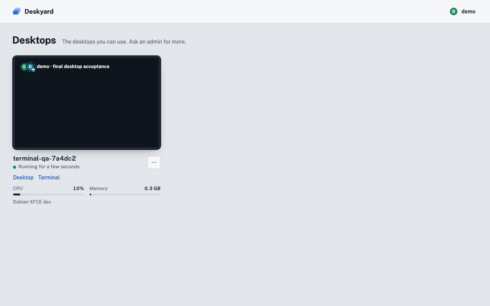

Open **Sessions**. To create a separate shell, enter a new name and choose **Create**; the running-session list has separate join actions.

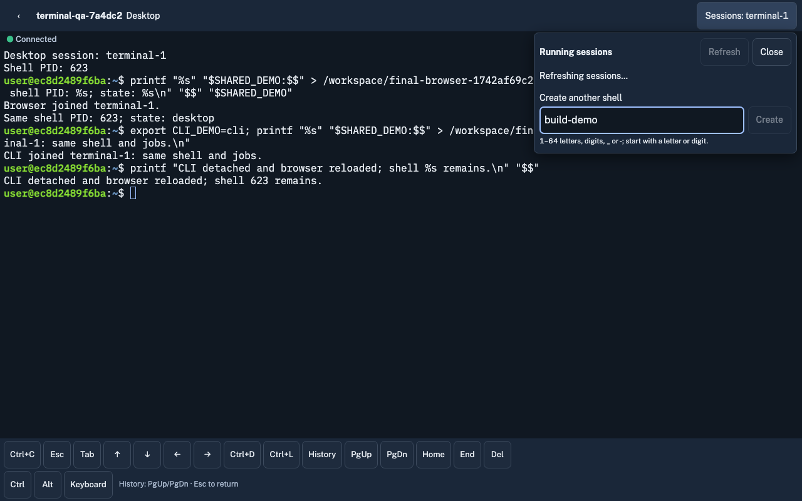

The new shell has its own process and environment. Ordinary native windows and tabs also create separate readable names, such as `terminal-1` and `terminal-2`.

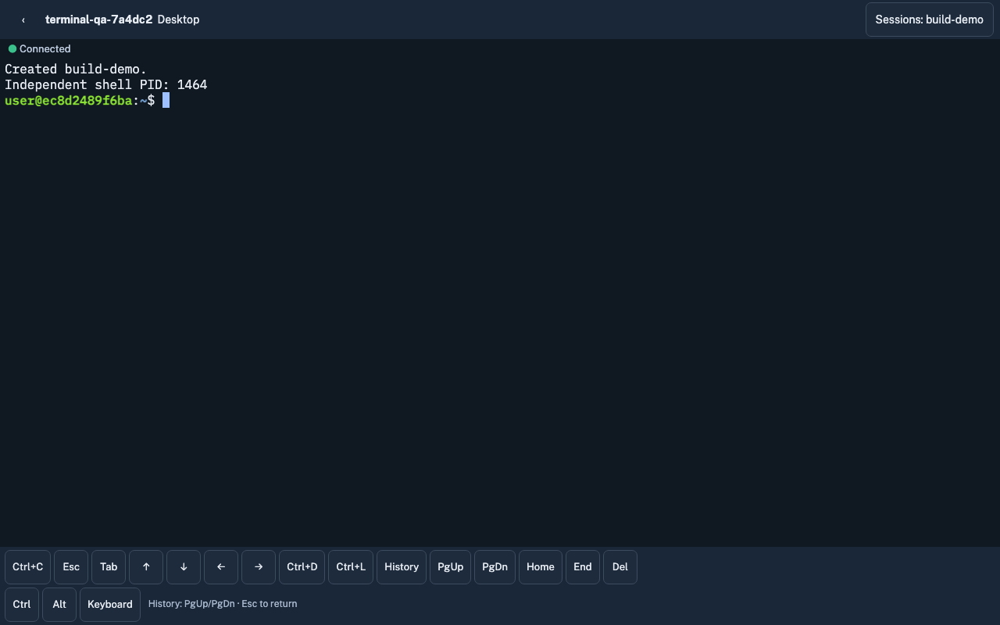

To join an existing shell, open **Sessions** and choose its name. Detached shells with running jobs remain listed. The active name is marked; closing the picker returns to the same terminal.

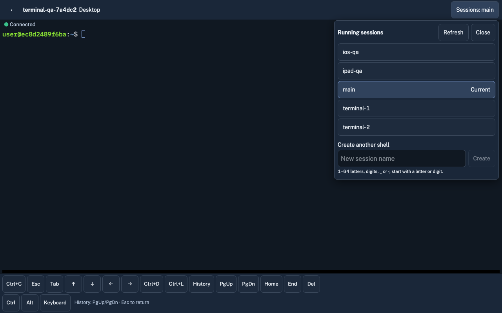

The browser picker and `deskyard -d alice terminal terminal-1` can join the exact shell opened by a native terminal. In a native shared terminal, **Ctrl-B then s** selects another public shell and switches only that native client. The native title follows the selected name.

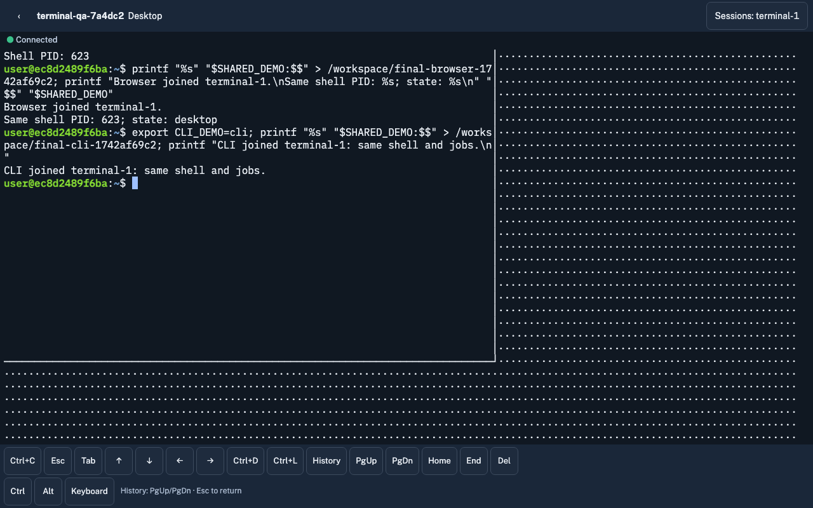

Native desktop launchers, default shortcuts and file-manager terminal actions start shared shells while preserving their working directory. Explicit emulator commands still run their requested program.

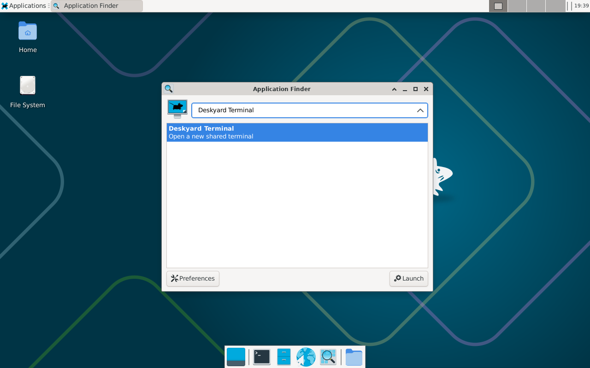

# Desktop verification

The final desktop proof recorded `terminal-1` with Bash PID 623, a second native tab `terminal-2` with PID 865, and browser-created `build-demo` with PID 1464. The actual browser Sessions picker and a host CLI PTY joined PID 623 with the same environment. CLI detach and browser reload preserved that shell. The guarded native chooser and native command prompt switched only the selected native client to `build-demo`; private lease groups were excluded and the native title followed the public name.

GNU nano 8.4 was installed only in the QA container. It rendered an actual ✓, accepted helper arrows/Home, saved with Ctrl-O and Enter, and exited with Ctrl-X back to Bash. The image does not bundle nano.

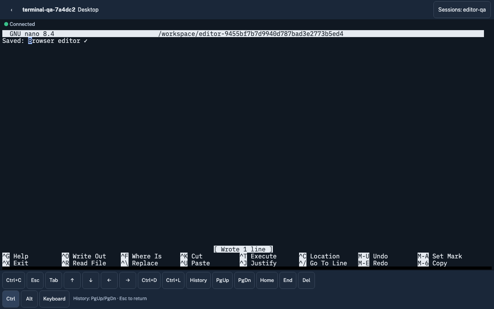

The [desktop demonstration](../superpowers/specs/2026-10-23-shared-terminal-design/media/desktop-browser.mp4) is a 13.48-second H.264 faststart video, fully decoded during verification. XFCE, MATE and KDE native launch paths, tabs, cwd, saved preferences, restoration and explicit programs passed; native chooser filtering, client identity and lease cleanup passed across all three desktops. All six focused XFCE terminal tests passed.

# Native mobile verification

On native iPhone 17 Pro / iOS 26.3 Safari, the final software-keyboard run proved Ctrl-C, Tab and a native software-keyboard q with actual shell effects. Sessions Create allocated a distinct `ios-final-213956` shell (PID 1817); joining `ios-qa` restored its original PID 362. Landscape left only 36px above the keyboard and accessory bar: the explicit rotate/dismiss fallback stayed visible and the software keyboard remained open. Returning to portrait, dismissing and reopening the keyboard passed. Earlier native iPhone checks covered Esc, arrows and Ctrl/Alt effects; native Android Chrome/Gboard covered the full helper bar, and native iPad portrait checks covered Ctrl-C, Tab and a native software-keyboard q.

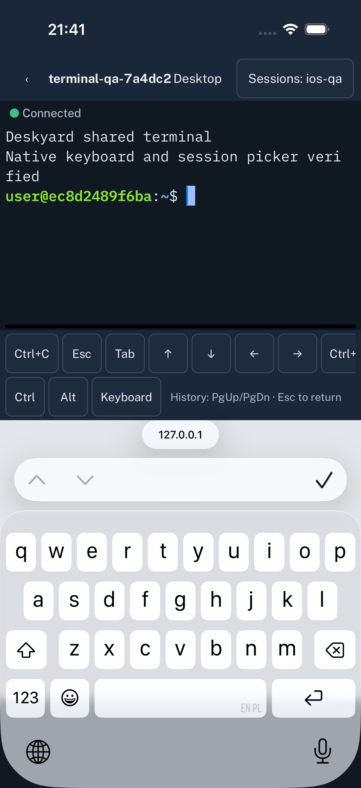

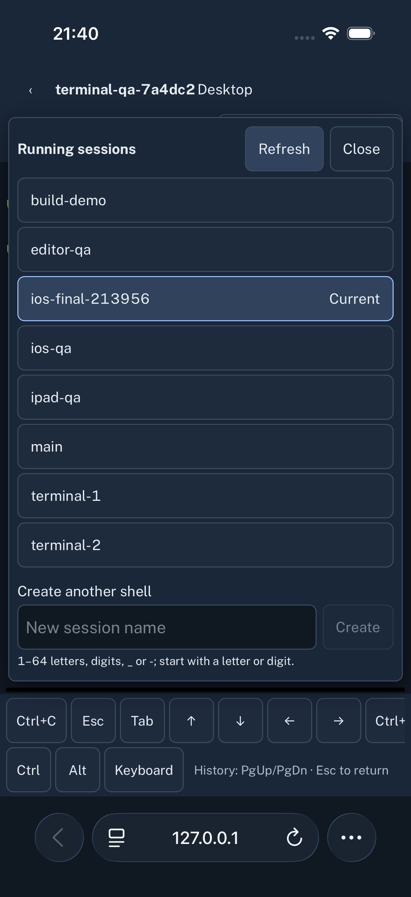

The retained landscape screenshot captures only the native fallback text element to avoid private browser content. It does not itself show the keyboard; the full native frame was checked separately to confirm that the keyboard remained open.

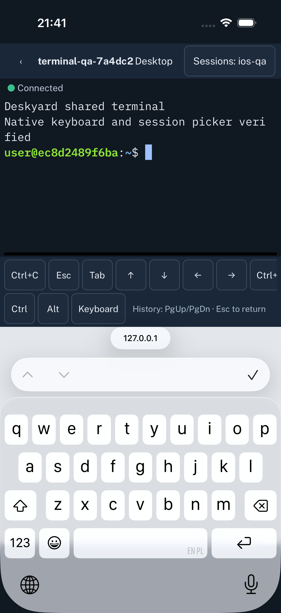

The final Android Chrome emulator picker run created a distinct shell (PID 2794) and rejoined the original shell (PID 2358). Picker actions and proof commands used CDP; earlier Android key-effect checks used native ADB/Gboard. The final iPad refreshed-UI focus test passed; its earlier real Ctrl-C, Tab and native software-keyboard q proofs remain the keyboard-effect evidence.

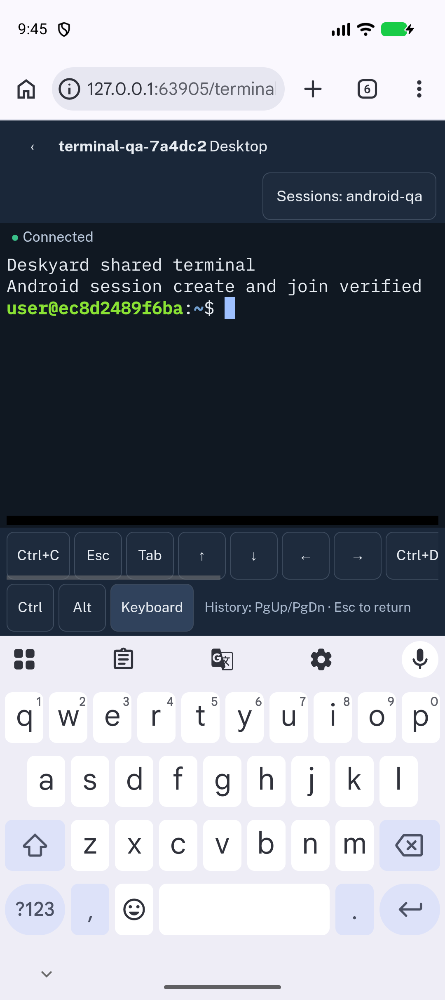

The [final native iPhone demonstration](../superpowers/specs/2026-10-23-shared-terminal-design/media/iphone-final.mp4) is an 18.88-second video. Full ffmpeg decoding passed, and an actual software-keyboard Ctrl-C frame was independently reviewed.

# Verification limits

Native Unicode paste remains unverified because the native automation harness failed that operation. Headless composition/Unicode coverage and actual nano UTF-8 bytes passed; those checks do not establish native paste behavior. These are simulator/emulator runs, not physical-device tests. Linux amd64 runtime execution was unavailable; Windows amd64 and Linux amd64 cross-compilation passed. Below 68px the available height cannot fit a readable row plus 44px controls: rotate to portrait or dismiss the keyboard. Safari Hide Toolbar is not a required workaround. History uses the explicit tmux History action rather than claiming native alternate-screen touch scrolling is fixed.

# Final verification

The final root `make test` completed with exit 0 against `deskyard-terminal-production:test` (image `sha256:b0d1ace37ba5b61fa5bc0cecadd2939deaa15dafea4260e87cfe9f03efaf95fa`). Go vet/race, 33 UI tests and engine checks passed. Image tests passed 98 parallel checks plus one serial restoration check; three MATE appearance checks were skipped in the XFCE run. Supervisor integration passed 133 parallel checks plus seven serial checks; nine Firefox checks were skipped because Firefox could not create its profile on this host. Separate native desktop acceptance covered XFCE, MATE and KDE. Supervisor `make build` passed.

Whole-feature review approved the implementation with one minor documentation finding: the historical spike needed an explicit supersession note. That note is now present. Markdown links, referenced paths and frontmatter passed static checks; SilverBullet Desktop rendered this walkthrough and its relative screenshot, and the generated Shared terminal architecture diagram. The retained 20-second Android video fully decoded; it documents the earlier keyboard proof, not the final picker UI. Native iPhone and desktop videos also fully decoded as recorded above.

Simulator cleanup restored the hardware-keyboard preference and original browser groups/tabs. Only the task’s own failed DeskyardQA Safari groups remain because native context-menu cleanup stalled; no unrelated tabs were affected. Diagnostic proxy, test runners and the task’s Android emulator were cleaned up.
