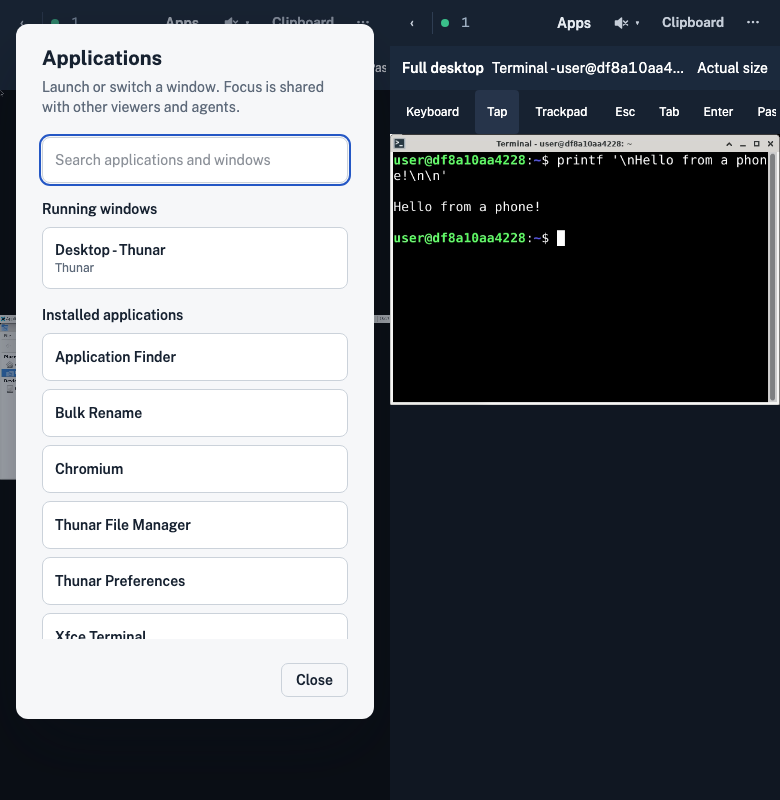
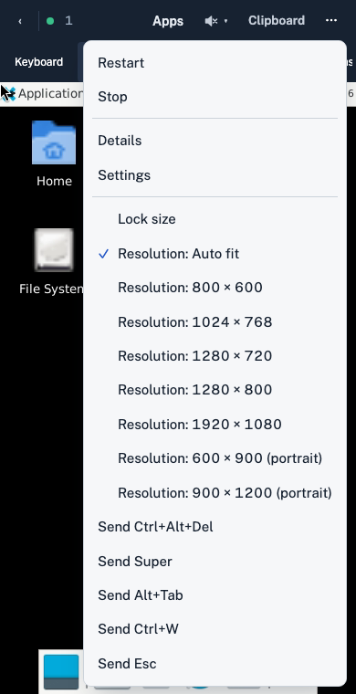

Prototype approved in chat: an installed-application launcher, running-window picker and browser-local focused view of the shared desktop. This is experimental; keyboard focus and remote window geometry remain shared.

# Implementation

- [x] Add a user-level image helper using Gio desktop entries and Wnck X11 window metadata; launch registered application IDs and activate existing window IDs.
- [x] Add authenticated supervisor inventory and action routes with bounded output, timeouts and validated inputs.
- [x] Add an Apps dialog, track selected windows and transient dialogs, and crop the existing iframe without replacing Selkies input or video. Keep a Full desktop escape hatch and a readable-size mode.
- [x] Verify region calculations, build/typecheck/Go tests, and a real mobile browser launch/input round trip in an isolated container. Update README, API and component documentation with prototype limits.

# Verification

Run `make typecheck`, `make test`, `make build` from `supervisor/`. Build an isolated prototype image and run `test_ui_applications.py` with a separate Docker subnet. Check the documentation diff and links. No changes to the main checkout or existing desktops.

# Results

- `make test` passed (Go, race detector); `make typecheck` passed with 18 UI tests; `make build` passed.
- Built `deskyard-debian-xfce:mobile-prototype` from this worktree. Two real Chromium mobile integration tests passed: terminal launch/input/return and shared Chromium launch, plus GTK button touch targeting and transient dialog discovery on a shared desktop with a differently sized viewer. Shared resolution changes preserve the focused iframe's aspect ratio.
- Existing stream and desktop-page regression tests: 17 passed, 8 skipped because Firefox could not start on this Mac, 9 deselected by the suite's markers (including WebKit). Physical phone/Safari keyboard behavior and Flatpak launches remain unverified.
- SilverBullet lint passed for the three changed architecture pages and this plan; the new component query returned `status: built`, `partOf: Architecture/Desktop`. Rendered the component page for inspection. `git diff --check` passed.
- Review fixed launch association with concurrently opened windows and focused-view stream-size synchronization. Integration fixed explicit CSS pixel units required by this Preact version; otherwise old percentage widths remained in the wrapper and touch coordinates did not align.

The helper is intentionally a short-lived exec process polled about once a second, not a persistent event service. Application icons, automatic window fitting, popup-menu capture outside window bounds, and independent input seats are follow-up work. The selected window stays in the same XFCE session; it may still be covered by another viewer's window.

# Full-desktop touch follow-up

The user requested usable general desktop touch input as well as application views. Implemented explicit Tap/Trackpad controls based on touch capability (including landscape/tablet widths), a real keyboard show/hide toggle, browser-local pinch magnification from 1× to 4×, two-finger panning while magnified, Fit screen, and a toolbar outside the magnified surface. Trackpad preference survives reconnect/reload. The page follows the software keyboard's visible viewport. At fit, two-finger scrolling still operates the application; a touch pinch does not send Ctrl+wheel to the application. No image rebuild is needed for these supervisor/client changes.

Verification includes anchor/bounds unit tests and real Chromium multi-touch events through the pinned Selkies client, keyboard input focus toggling, direct vs relative pointer behavior, local panning, magnified tap alignment, unchanged remote resolution, and preference restoration after reload. Physical phone/Safari software-keyboard behavior remains unverified.

The follow-up passed `make test`, `make typecheck` (20 unit tests), and `make build`. All three real Chromium mobile integration tests passed, including a gradual pinch, a stationary pinch without magnification drift, repeated pan moves, the 4× clamp/pan/inward-pinch edge case, magnified tap alignment, and trackpad preference after reload. Review corrected gesture coordinates into the top-level viewport so CSS transforms do not feed back into pinch/pan measurements, and retained the requested input mode until Selkies initializes. SilverBullet lint passed for the changed pages. The existing local demo on port 8097 was rebuilt and its phone controls verified. The existing desktop/stream regression run also passed: 17 passed, 8 Firefox skips, 9 deselected by markers.

# Recorded walkthrough

Captured the running prototype at a 390×800 phone viewport with Chromium touch emulation. The 42-second recording shows the application launcher, focused terminal and text input, full-desktop Tap/Trackpad controls, local pinch magnification, two-finger panning, Fit screen, and switching back to an existing window. Captions are recording annotations; an operating-system software keyboard is not included in the browser recording. The temporary capture desktop was removed afterward.

[Play the walkthrough](2026-10-23-mobile-app-prototype/mobile-walkthrough.mp4).

Additional screenshots: [full desktop](2026-10-23-mobile-app-prototype/01-full-desktop.png), [pinch magnification](2026-10-23-mobile-app-prototype/05-pinch-zoom.png), and [running-window switcher](2026-10-23-mobile-app-prototype/06-window-switcher.png).

# Plain HTTP LAN demo

Reused main's existing plain HTTP implementation (merge `a6bb279`) in this older prototype worktree, preserving the mobile gestures and window views. The shared client additions provide the JPEG/WASM and audio fallback; quality presets, the connection note, and controls that require HTTPS match main. Removed the temporary duplicate patch to the minified client. README and the Desktop proxy/Selkies architecture pages include main's LAN behavior and limitations.

Verification: `make typecheck` (21 unit tests), `make test`, and `make build` passed. All four mobile Chromium integration tests passed, including a real insecure HTTP origin with no VideoDecoder. Verified the actual LAN HTTP endpoint with the restricted demo account: live stream, Tap/Trackpad switching, and Apps launcher. Physical phone/Safari behavior remains unverified.

Main's three plain HTTP regression tests also passed (screen/input, upload/download, sound/quality). SilverBullet lint passed for the plan and both affected architecture pages; `git diff --check` passed.

# Remote resolution and trackpad edge follow-up

Added remote resolution choices beside Lock size on wide screens and in More on compact screens: 800×600, 1024×768, 1280×720, 1280×800, 1920×1080, 600×900 and 900×1200. Selecting one applies and saves the existing resolution lock; Auto fit clears it. The shared first-viewer ownership and focused-crop constraints remain.

Trackpad mode follows the active single-finger cursor at the visible viewport edges, panning local magnification and Actual size window crops. Pointer echoes include pending motion, and stored touch coordinates compensate for iframe scrolling to prevent feedback from a stationary finger. Following stops when the finger lifts; pointer movement from another viewer does not move the local view.

Verification: `make typecheck` (21 unit tests), `make build`, and `make test` passed. All six mobile integration tests passed. The existing desktop-page suite plus mobile tests passed 19 tests, with 7 Firefox skips and 7 marker deselections. Additional checks verified all four panning directions and stationary-finger stability, resolution persistence through rotation/reload, portrait selection, Auto fit, and the wide-screen dropdown. The live :8099 LAN endpoint was restarted and checked with the demo account. SilverBullet lint and `git diff --check` passed.

# Home Screen app follow-up

Added install metadata, icons, safe-area and dialog spacing, standalone viewport correction, and a solid iOS top-edge buffer. Native iPhone 18 Pro / iOS 27 testing verified Add to Home Screen, standalone launch/session retention, the live stream, actual software-keyboard typing/hiding, rotation and focused-window switching. Observed and measured the native blur and standalone height discrepancy before correcting them. Full evidence and remaining limits are in [[Testing/PWA iOS 27|PWA testing — iOS 27]].

PWA follow-up verification: 23 UI unit tests, Go/race tests and the build passed; the combined browser run passed 22 tests with 7 Firefox skips and 7 deselections. The optional WebKit PWA/notch test passed explicitly. Review found and corrected its default-suite marker. Native foreground resume retained a connected stream and Trackpad mode. README, Web UI architecture, the Selkies design follow-up and [[Testing/PWA iOS 27|PWA testing — iOS 27]] document implementation, install instructions, evidence and limits.
