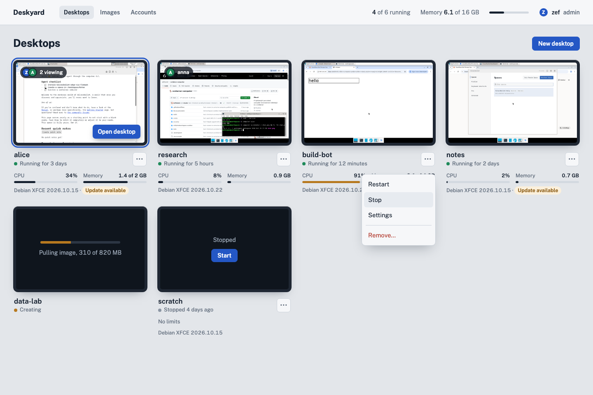
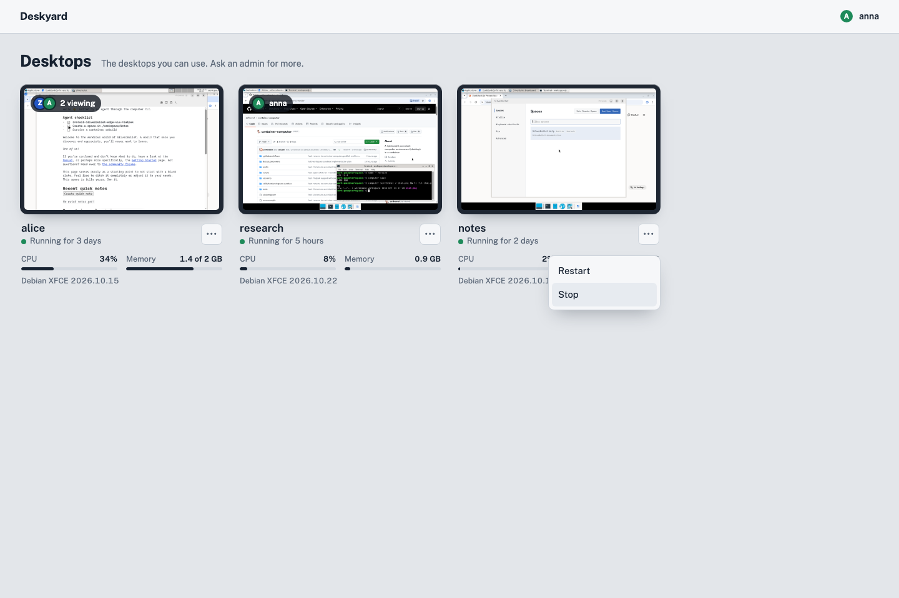
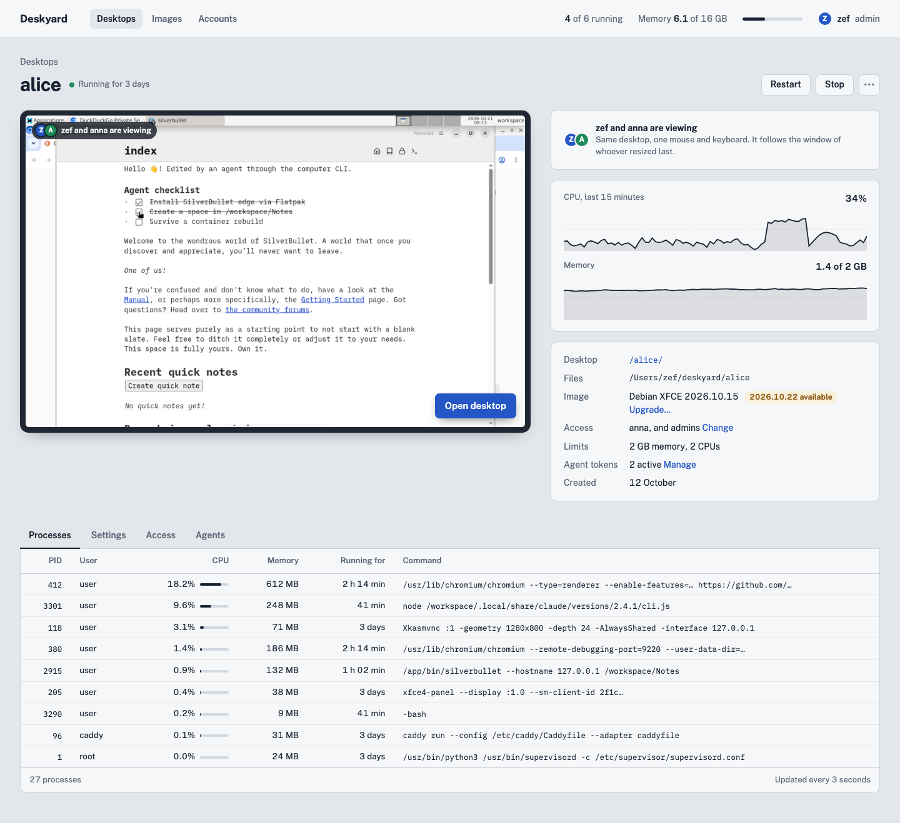

The supervisor is one Go binary that creates, runs and shares many desktops: persistent Linux desktops in containers. The product is called **Deskyard** through the container engine (Docker now, Podman later). It has accounts, and each desktop has a list of accounts that may use it. Agents elsewhere use a desktop through the same `deskyard` command that's inside it, with a token an admin hands out. The repository splits into the supervisor and the desktop images. Mockups are in the UI section; their HTML sources are in the folder next to this page.

# Intent

Today one `docker compose up` gives one desktop: a persistent Linux desktop shared by a human and an AI agent. Running several means juggling project names, ports, home folders and passwords by hand, and sharing one with another person means sharing its password.

With this design the supervisor becomes **the only way to run desktops** (decided). The standalone `docker compose` setup, with its password, basic auth, own HTTPS and host ports for agents, goes away; running a single desktop means running the supervisor with one desktop. That leaves one auth model, one network setup and one way in for agents, instead of two of each.

The supervisor turns this into something like a small VMware for these desktops: one web app where you sign in with your own account and create, open, start, stop, restart, upgrade and remove **desktops**, and see what each one is doing (CPU, memory, processes). Desktops are **shared**: everyone with access to a desktop opens the same desktop, at the same time if they like, the way two people look at one screen. Each desktop is reached in the browser at `https://host/<name>/`.

Some users are agents running elsewhere (on a laptop, in CI, in another sandbox). Anyone with access to a desktop can give such an agent a token for it; with it, the `deskyard` command gets a shell, the shared browser and the desktop of that desktop over HTTPS.

It ships as one binary, run directly on a machine with Docker or in a small Alpine container. The audience is a person or a small team running a handful to a few dozen desktops on a laptop, a home server or a VPS.

# Vocabulary

- **Desktop**: a container and its workspace folder. Has a name, e.g. `alice`.
- **Supervisor**: this app: one Go binary with its web UI built in. (Not to be confused with `supervisord`, which runs the services inside every desktop.)
- **Account**: a person who signs in to the supervisor. Either an **admin** or a regular account.
- **Access**: the accounts allowed to use a desktop, set per desktop by admins.
- **Viewer**: one open desktop connection to a desktop (a browser tab). One account can be several viewers.
- **Desktop image**: an OCI image that follows the image contract (see Images). The repository starts with one, `debian-xfce`, today's image.
- **Engine**: the container engine the supervisor drives: Docker now, Podman later.
- **Workspace folder**: the desktop's `/workspace`, its user's home: a folder on the host under the supervisor's data folder, e.g. `~/deskyard/alice`.
- **`user`**: the single Linux user inside every desktop. Everyone who opens the desktop works as `user`.
- **Agent token**: a secret someone with access creates for one desktop, so an agent elsewhere can use that desktop through the agent API.
- **`deskyard` command**: one Go binary. Inside a desktop it controls that desktop; given a **remote** (a desktop's address and an agent token) it does the same over HTTPS.

# Goals

- **One binary.** Go backend with the Preact + Tailwind frontend compiled in. Runs directly on Linux and macOS (amd64, arm64), or as the image `ghcr.io/zefhemel/deskyard` (Alpine-based, multi-arch).
- **Accounts.** Username and password, stored hashed in a JSON file. Admins create accounts and set passwords; there's no reset flow, email or SSO. An account is an admin or not.
- **Access per desktop.** Admins choose which accounts may use each desktop. Admins can use every desktop.
- **Shared desktops.** Several viewers on one desktop at once, all on the same desktop, which follows the browser window of whoever resized last.
- A real login page (a form, so password managers fill it) and a session cookie. Desktops have no password of their own under the supervisor.
- A wall of all desktops you can use, with a live screen thumbnail, status, CPU, memory and who's viewing; one click to open a desktop.
- Lifecycle: create, start, stop, restart, remove.
- Per desktop: live CPU and memory (current and last 15 minutes), processes, settings, access.
- **Several desktop images.** Pick one when creating a desktop; see when a newer version of a desktop's image is available; upgrade desktops to it (security updates, new features) keeping their folder and settings, or switch a desktop to another image.
- Each desktop's desktop at `/<name>/` on the supervisor's address (decided: path prefixes, not subdomains).
- Workspace folders are plain folders on the host (decided), so they can be browsed and backed up with host tools.
- Works on a laptop out of the box (`http://localhost:8080`), and on a server with automatic HTTPS when given a domain (decided).
- **Agents from elsewhere.** Anyone with access to a desktop can create agent tokens for it (named, optional expiry, revocable). With one, the `deskyard` command gives an agent a shell (single commands and interactive), file upload and download, the shared browser (as a local CDP port) and every screen action, over HTTPS and WebSockets only. The command describes itself well enough for an agent to learn it from `--help`, `deskyard guide` and `deskyard describe --json`.
- Prepared for Podman: everything goes through an engine interface with one implementation (Docker) for now.

# Non-goals (for now)

- Podman support itself (the design keeps the door open; see Engine).
- Running desktops without the supervisor (decided: the standalone `docker compose` mode is removed).
- An MCP server mode for the `deskyard` command (decided: never; the self-describing CLI is the interface).
- Per-tool permissions on tokens: a shell can do everything the other tools can, so a token is all or nothing for its desktop.
- Self-service: regular accounts can't create, remove or change desktops, or manage accounts.
- Password resets by email, SSO/OAuth, two-factor login, roles beyond admin/regular.
- Telling viewers apart on a shared desktop (one mouse, one keyboard; the supervisor knows who is connected, not who clicked).
- Managing more than one engine host.
- Clone (decided: not in v1; workspace folders are plain host folders, so copy one and create a desktop with that name to get a copy), snapshots and backups.
- Container logs in the UI (decided: dropped; `docker logs` on the host still works for admins).
- A sudo-capable desktop variant (decided: every desktop runs with Flatpak support and without sudo; only `/workspace` survives upgrades anyway).
- A separate cache volume per desktop (decided: caches live in `/workspace` like on any Linux machine).
- Publishing arbitrary ports from desktops (an agent's dev server) on the supervisor's address. See "Path prefixes and the shared origin".
- Managing containers the supervisor didn't create.

# Anti-goals (failure even if it works)

- Any route of the supervisor reachable without signing in, other than the login page and its static assets.
- An account reaching a desktop it has no access to, through the UI, the API or the desktop WebSocket.
- An agent token reaching anything but its own desktop's shell, files, browser and desktop: no other desktop, no lifecycle, settings or accounts, and nothing as root.
- A desktop (i.e. an agent inside it) able to reach another desktop's desktop, VNC or CDP, or the engine socket.
- Losing a workspace folder through a misclick: removing a desktop keeps its folder unless the admin explicitly ticks "also delete files".
- Stored state that can drift from what the engine says exists.

# Constraints and facts this design rests on

- **The engine socket is root on the host** (rootful Docker and rootful Podman). Whoever can use it owns the machine, so the supervisor is the most privileged thing on it. It never runs agent-provided code, and every request needs a signed-in account.
- **Desktops are dangerous as root**: every desktop runs with Flatpak support (`systempaths=unconfined`, so container root can write host `/proc/sys`). The existing rule stays: nothing agent- or internet-reachable in a desktop runs as root, and there's no sudo; the supervisor starts desktops with the security options compose uses today for Flatpak mode.
- **Bind-mount paths given to the engine are host paths.** When the supervisor itself runs in a container, its data folder must be mounted at the same path (see Storage).
- **KasmVNC already allows shared sessions**: the image starts it with `-AlwaysShared`, so several connections see and drive the same desktop.
- **The KasmVNC web client** loads its assets with relative URLs (works under a prefix), but opens its WebSocket at `/<path setting>` with `path` defaulting to `websockify`, i.e. at the site root. It stores its settings in `localStorage`, per origin; URL query parameters override them.
- **The web client's settings are per origin**, so with path prefixes all desktops share one set (quality, clipboard). Acceptable. The resize mode (remote) is set in the frame's URL, not by stored settings.
- **Container labels can't be changed** without recreating the container. Anything that changes often (access) therefore lives in the supervisor's own files, not in labels.

# Architecture

```
browser ──HTTPS──▶ supervisor (one Go binary, on the host or in its own container)
                    ├─ /login, /logout, /api/*, /     UI (Preact + Tailwind, embedded)
                    ├─ /<name>/                       KasmVNC web client, served by the supervisor
                    │                                 (extracted from the desktop's image)
                    ├─ /<name>/websockify ──WebSocket──▶ deskyard <name>:8080 (Caddy ─▶ KasmVNC)
                    ├─ /api/agent/v1/*                agent API (token): exec, shell, files, CDP
                    └─ engine socket ─▶ create/start/stop/stats/top/exec/pull

agent elsewhere ── deskyard -d alice … ──HTTPS/WebSocket──▶ /api/agent/v1/*
```

- **One Go binary** serves the UI (built assets embedded with `embed`), the JSON API, the login, and the proxy to desktops. HTTPS via CertMagic (Caddy's ACME library) when `DESKYARD_DOMAIN` is set; otherwise plain HTTP on `DESKYARD_LISTEN` (default `127.0.0.1:8080`).
- **The engine is the database for desktops.** Every desktop is a container labelled `deskyard.managed=true`, `deskyard.name=<name>` and `deskyard.id=<uuid>`; its settings are labels too (see Settings). The supervisor keeps no list of desktops of its own.
- **The supervisor's own state** is small and lives in its data folder: accounts and access (`accounts.json`), agent tokens (`tokens.json`), the image catalog (`images.json`), the session signing key and ACME certificates.

## Running it

- **Directly:** download the binary for your OS (`deskyard-supervisor-<os>-<arch>` from the releases) and run it. It finds the engine at `DESKYARD_ENGINE_HOST`, else `DOCKER_HOST`, else the platform default (`/var/run/docker.sock`, or Docker Desktop's/OrbStack's socket on macOS). The user running it must be able to use that socket (on Linux: the `docker` group, which is root-equivalent; the docs say so). For HTTPS on 80/443 on Linux, the docs show `setcap cap_net_bind_service` or a systemd socket.
- **In a container:** `ghcr.io/zefhemel/deskyard`, Alpine-based, the binary plus CA certificates and tzdata. Mount the engine socket and the data folder (at the same path). A `compose.yaml` in `supervisor/` shows it.

## Engine

All supervisor logic talks to an engine interface of its own (`internal/engine`), never to an engine SDK directly. Roughly: containers (create, start, stop, remove, inspect, list by label, exec, top, stats stream), networks, images (pull, inspect, copy files out), events. One implementation now, `internal/engine/docker`, using the Docker Go SDK with API version negotiation; no shelling out to CLIs.

To keep the door open for Podman:

- Everything the supervisor stores on containers is labels, which both engines support the same way.
- Engine-specific spellings stay in the engine package: security options (`systempaths=unconfined` for Flatpak, seccomp profile, devices, capabilities), restart policy, how a desktop is reached (see below).
- No Docker-only conveniences in the design: no `host.docker.internal`, no Compose at runtime.
- One engine test suite runs against the interface. Adding Podman means a second implementation passing it. Podman's Docker-compatible API (`podman system service`) may let the Docker implementation work as it is; that's the first thing to try.
- Rootless Podman would change the risk picture for the better (container root isn't host root, which defuses the `/proc/sys` issue). Workspace folder ownership then goes through a UID mapping, so ownership is the engine's business, not a hard-coded `PUID:PGID`.
- Known Podman differences to handle then: restarting desktops after a reboot (systemd/quadlet instead of a daemon restart policy), networking in rootless mode, security option names.

## Networks and reaching a desktop

Each desktop gets its own bridge network `deskyard-<name>`, so desktops can't reach each other where the engine isolates bridge networks (Docker on Linux). OrbStack and Docker Desktop route between bridge networks, so there the per-desktop token is what keeps one desktop out of another's desktop (Caddy answers 401 without it); the integration tests accept either. The supervisor reaches a desktop one of two ways, decided by where it runs:

- **Supervisor in a container:** it connects itself to every `deskyard-<name>` network and reaches `alice` at `cc-alice:8080`. Desktops publish nothing. On startup it reconnects to any network of a managed desktop it's missing from.
- **Supervisor on the host:** a host process can't reliably reach container addresses (Docker Desktop, OrbStack, rootless Podman), so each desktop publishes its port 8080 on host `127.0.0.1` at a port the supervisor picks, stored as a label.

In both cases the per-desktop token (see The desktop behind the supervisor) is what lets the supervisor in. On Docker Desktop and OrbStack a desktop can reach the host's `127.0.0.1` ports (and so another desktop's published port), and without the token it gets 401.

Docker's default address pools only hold about 30 bridge networks, so the supervisor gives each network an explicit /28 from `DESKYARD_SUBNET` (default `10.213.0.0/16`, room for 4096 desktops).

## The desktop behind the supervisor

A desktop is only ever run by the supervisor, so the image's front door gets simpler:

- Caddy (still on 8080, still as user `caddy`) requires the header `X-Deskyard-Token: <token>` on every request, where the token is 32 random bytes the supervisor generates per desktop and passes in `WORKSPACE_PROXY_TOKEN`. Without the variable the desktop refuses to start. Caddy then serves KasmVNC's WebSocket and the `/_cdp/` route, and nothing else.
- Gone from the image: `WORKSPACE_PASSWORD` and its generated password, basic auth, Caddy's HTTPS and domain support (`compose.domain.yaml`), the Origin check (the supervisor does it), and the compose files.

There's no per-desktop password: the supervisor login is the only way in. There's no `sudo` (`WORKSPACE_SUDO` and the non-Flatpak variant go).

**Only one port.** Today a desktop publishes 8080 and, for agents on the host, VNC (5901) and CDP (9222) on `127.0.0.1`. Agents now use the agent API instead, so a desktop publishes **nothing** when the supervisor runs in a container, and only 8080 on host `127.0.0.1` when it runs directly (see Networks). The listeners that only existed for those host ports (the VNC bridge on 5901 and CDP on 9222, both on all interfaces) are removed from the image; what's left on the network is Caddy on 8080, behind the token. Inside the desktop, CDP on `127.0.0.1:9221` stays for agents running there.

## `/<name>/`: our desktop page, the web client in a frame, only the WebSocket proxied

A desktop can't be trusted to serve pages on the supervisor's origin: the agent runs as the same user as KasmVNC, so it can replace KasmVNC's web server. Script from such a page would run with a signed-in account's cookie, and an admin's cookie drives the engine socket. So the supervisor **never proxies HTTP content from a desktop**:

- The supervisor serves the KasmVNC web client itself, extracted from the desktop's **image** (never from the running container): on first use of an image ID it copies `/usr/share/kasmvnc/www` out of a never-started container of that image and caches it per image ID. Client and server versions always match.
- `/<name>/` is the supervisor's own **desktop page** (part of the web UI, see Desktop page): our chrome around the desktop, with the KasmVNC client in an iframe at `/<name>/vnc/`. We own this UI from day one: the client's own control bar is never shown, and anything people need from it moves into our chrome.
- The iframe loads `/<name>/vnc/vnc.html?path=<name>/websockify&autoconnect=1` `&resize=remote`, so each desktop connects to its own WebSocket even though they share stored settings. Query parameters win over the client's stored settings, so a viewer can't end up with the control bar or another desktop's path.
- `/<name>` redirects to `/<name>/`.
- `/<name>/websockify` is the only thing proxied: a WebSocket to the desktop's port 8080, with the token header added and the session cookie removed (the desktop never sees it). Anything else under `/<name>/vnc/` that isn't a client file is a 404.
- Every request under `/<name>/` checks that the signed-in account has access to that desktop (admins always do); otherwise 404, so names of other desktops don't leak.
- WebSocket upgrades are rejected (403) unless `Origin` matches the supervisor's own origin.
- A stopped desktop's desktop page shows "alice is stopped" with a Start button (for anyone with access) instead of the frame.

## Path prefixes and the shared origin

All desktops and the UI share one origin, so any script on it can call the API with the viewer's cookie. Every page on the origin therefore comes from the supervisor (its own UI, and web client files taken from images). What a malicious desktop can still do over its WebSocket: send arbitrary screen data to the client (parsed by decoders, no script), and put text on a viewer's clipboard while its desktop is open (as today). Accepted.

- No "open port 3000 of alice at /alice/3000". If publishing agent-controlled web content is wanted later, it gets a separate origin (another port, or `*.apps.example.com`), not a path.
- The session cookie is `HttpOnly`, `SameSite=Strict`, `Path=/`, `Secure` under HTTPS.

## Names

`^[a-z][a-z0-9-]{0,30}[a-z0-9]$` (DNS label rules, so it also works as a container, network and folder name). Reserved, because they're supervisor routes: `api`, `login`, `logout`, `assets`, `static`, `healthz`, `favicon.ico`, `robots.txt`, the UI's pages `desktops`, `images` and `accounts`, and anything starting with `_`. Names can't be changed after creation (to rename: remove it keeping its folder, rename the folder on the host, and create it again).

Engine names: container `deskyard-<name>`, network `deskyard-<name>`.

# Accounts and access

- `accounts.json` in the supervisor's state folder, mode 0600, written atomically (temporary file + rename) under a lock:

```json
{
  "accounts": [
    {
      "username": "zef",
      "passwordHash": "$argon2id$v=19$m=65536,t=3,p=2$…",
      "admin": true,
      "sessionEpoch": 3,
      "desktops": ["6f1c…", "a03e…"],
      "created": "2026-10-22T09:12:00Z"
    }
  ]
}
```

- **Usernames**: `^[a-z][a-z0-9._-]{0,31}$`, case-insensitive unique.
- **First start**: if there's no `accounts.json`, the supervisor creates an admin from `DESKYARD_ADMIN_USER` (default `admin`) and `DESKYARD_ADMIN_PASSWORD`, or a generated password printed once in its log, as the desktop image does today.
- **Admins** create and delete accounts, set any account's password, and make accounts admin or not. The last admin can't be deleted or demoted. Every account can change its own password.
- **Access** is the `desktops` list: desktop IDs (the `deskyard.id` label), not names, so a new desktop that reuses a removed desktop's name doesn't inherit its access. Removing a desktop removes its ID from every account; IDs of desktops that no longer exist are pruned on startup.
- **Sessions**: signed cookie carrying username and `sessionEpoch`; 30 days, sliding. Changing a password, deleting an account or demoting it bumps the epoch, which signs that account out everywhere. Revoking access to a desktop also closes that account's open desktop connections to it.

What each kind of account can do:

| | Admin | Regular account |
| --- | --- | --- |
| See and open desktops | all | those it has access to |
| Start, stop, restart | all | those it has access to |
| Processes, activity | all | those it has access to |
| Create, remove, change settings, upgrade | yes | no |
| Create agent tokens, revoke own | yes | for those it has access to |
| Revoke anyone's agent tokens | yes | no |
| Accounts, access, image catalog | yes | no |
| Change own password | yes | yes |

# Shared desktops

Everyone with access opens the same desktop. KasmVNC already supports this (`-AlwaysShared`); the supervisor adds who's viewing:

- The supervisor knows which account each desktop WebSocket belongs to. Tiles show a viewer count, the details page lists the names, and the desktop page's chrome shows who's here and a short "anna joined" note when someone joins.
- **Screen size**: every viewer's frame uses remote resize, so the desktop follows the browser window of whoever resized last (decided: no switching between modes). Viewers with different window sizes see it scaled or letterboxed until they resize.

Not in scope: per-viewer cursors, input locks ("only one person drives"), or telling who typed what.

# Desktop page

The page at `/<name>/`: a thin bar of our own above the desktop, and the KasmVNC client filling the rest in an iframe with its control bar hidden. The page talks to the client through the client's `postMessage` API, and, since both are on the supervisor's origin, through its settings where that API falls short. Nothing of ours is added to the client's own files.

The bar, left to right:

- **Back** to Desktops, the desktop's name and status, and who's viewing (avatars).
- **Clipboard**: shows the desktop's clipboard text as it changes (from the client's `clipboardrx` message) with Copy, and a box to send text to the desktop's clipboard (`clipboardsnd`). Over HTTPS, copy and paste also go straight to the system clipboard (the iframe gets `allow="clipboard-read; clipboard-write"`).
- **Keys**: keys the browser would otherwise take: Ctrl+Alt+Del, Super, Alt+Tab, Ctrl+W, Esc, F11.
- **Quality**: a few presets (`setvideoquality`).
- **⋯**: Restart and Stop (for anyone with access), Settings and the details page.

Connection state (`connection_state`, `disconnectrx`) shows in the bar: Connecting, Connected, Reconnecting, and a Reconnect button after a failure. Keyboard focus stays in the frame unless the bar is being used.


# Agent access

From outside a desktop there is exactly one way in for agents: the agent API, used through the `deskyard` command. Agents don't get `docker exec`, engine access or host ports; the documentation and skills say so, and the outside-the-sandbox skills and the README's `docker exec` instructions are replaced by `deskyard` remotes. (The supervisor itself uses the engine's exec internally to carry out agent API calls; that's an implementation detail, not an access path.)

An agent that runs somewhere else uses a desktop through the `deskyard` command, the same command and subcommands it would use inside the desktop, plus a few that only make sense remotely. Everything goes over the supervisor's HTTPS port: plain HTTP for short calls, WebSockets for anything interactive or streaming.

## Agent tokens

- Anyone with access to a desktop creates a token on its Agents tab: a name ("claude on zef's laptop") and an optional expiry (never, 7, 30 or 90 days, or a date). The token is shown once, with the `deskyard remote add` line to paste into the agent's machine.
- A token reaches exactly one desktop, and only the agent API: shell, files, browser, desktop. Not the UI, not lifecycle, settings, accounts or other desktops. A shell can do everything the other tools can, so there are no finer permissions.
- Format `dyt_<id>_<secret>` (32 random bytes). `tokens.json` in the state folder keeps the ID, name, desktop ID, a SHA-256 of the secret (the secret is random, so a slow hash adds nothing), who created it and when, the expiry and when it was last used. Written atomically like `accounts.json`.
- An expired or revoked token stops working at once, and the supervisor closes its open shells, browser connections and streams. Expired tokens stay listed as "Expired" until deleted. Removing a desktop deletes its tokens.
- Everyone with access sees all of the desktop's tokens and who created them; they can revoke their own, admins can revoke any. A token lives no longer than its creator's access: when the creator loses access to the desktop or the account is deleted, their tokens for it are revoked.
- Every agent API call is logged by the supervisor with the token's name: the command line for exec, the path for files, connect and disconnect for shells and the browser.

## The agent API

All under `/api/agent/v1/`, authenticated with `Authorization: Bearer <token>` (no cookies, so no CSRF checks; the session cookie is never accepted here). The desktop is the token's; a stopped desktop answers 409 with "alice is stopped; someone with access can start it" (decided: agents can't start desktops).

| Endpoint | What |
| --- | --- |
| `GET /api/agent/v1` | The desktop's name, status, image and version, screen size, API version: what `deskyard remote add` and `deskyard status` show |
| `GET /api/agent/v1/exec` (WebSocket) | Run one command: the first message gives `argv`, optional `cwd`, `env` and `tty` (with a size); then stdin goes in and stdout and stderr come out as they arrive, and the last message is the exit code. With `tty` it's an interactive terminal, with resize messages |
| `/api/agent/v1/cdp/…` (HTTP and WebSocket) | The shared Chromium's DevTools protocol, proxied |

Everything else is built on exec in the CLI: `deskyard exec` and `deskyard shell` directly, `deskyard cp` by streaming through `cat` and `tar` as `user`, and screen actions by running the in-desktop `deskyard`.

How the supervisor carries these out:

- **Exec** uses the engine's exec as `user` (UID 1000) in `/workspace`, never as root, with the desktop's normal environment. File copies go through it too, never the engine's copy API, which writes as root and could change anything in the container.
- **Screen actions** need no endpoint of their own: the remote `deskyard` runs the in-desktop `deskyard` (screenshot, click, type, …) through exec. Every desktop tool works remotely as soon as it exists inside.
- **CDP** goes to the desktop's Caddy: Caddy serves `/_cdp/` (HTTP and WebSocket), checks the per-desktop proxy token like everything else, and forwards to Chromium's CDP port inside (`cdp-connect`, which starts Chromium if it isn't running). The supervisor rewrites `webSocketDebuggerUrl` and friends in `/json` responses so they point back through itself.

## The `deskyard` command

One Go binary (`supervisor/cmd/deskyard`) replacing today's bash script inside the image, and released for Linux, macOS and Windows for agents elsewhere.

- **Remotes**: `deskyard remote add alice https://host/alice --token dyt_…` checks the token against `GET /api/agent/v1` and saves the remote in `~/.config/deskyard/remotes.json` (mode 0600). `deskyard remote list`, `remove`, and `default alice`. `-d alice` (or `DESKYARD_REMOTE=alice`) picks one; `DESKYARD_URL` and `DESKYARD_TOKEN` work without a config file. Inside a desktop with no remote chosen, it acts locally.
- **Shell**: `deskyard exec -- cmd args` (exit code passed through; `--json` for stdout, stderr and exit code as one object), `deskyard shell` (interactive), `deskyard cp ./local alice:/workspace/x` and back.
- **Browser**: `deskyard browser connect [--port 9222]` listens on `127.0.0.1` and forwards to the desktop's CDP, so Playwright's `connectOverCDP`, Puppeteer or chrome-devtools tools work as if the browser were local. That's the only browser command (decided): for a quick look without browser tooling, agents use the deskyard commands.
- **Screen**: every `deskyard` screen action (`screenshot`, `zoom`, `click`, `type`, `key`, `scroll`, `drag`, …) with the same arguments and output, remote or local.
- **Self-describing**:
  - `deskyard --help` and every subcommand's `--help` say what it does, its arguments, an example and what it prints;
  - `deskyard guide` prints a short manual for agents: how the desktop is laid out, the three ways to work (shell, browser, desktop) and when to use which;
  - `deskyard describe --json` lists every command with its arguments, types and output shape, so an agent can load it as a tool schema;
  - errors say what to do next ("no remote chosen: run `deskyard remote list`, then use -d NAME"), and exit codes are documented.

# Images

The repository builds desktop images under `images/`; it starts with one, `images/debian-xfce` (today's image).

**The image contract** is what the supervisor relies on in any desktop image, declared with labels so the supervisor can check it before using an image:

- `deskyard.contract=1` (the supervisor refuses images without it, or with a contract version it doesn't know), plus `org.opencontainers.image.title`, `.version` and `.description` for the UI.
- One user, `user`, UID 1000, home `/workspace`. Everything that should survive an upgrade lives under `/workspace`.
- Port 8080: Caddy in front of KasmVNC, checking `WORKSPACE_PROXY_TOKEN` as above; the web client at `/usr/share/kasmvnc/www`.
- The `deskyard` command, in particular `deskyard screenshot` for thumbnails and the screen actions the agent API runs through exec.
- Caddy's `/_cdp/` route to the shared Chromium's CDP.
- Settings via the `WORKSPACE_*` environment variables (start resolution), and a container health check.

**The image catalog** (`images.json`, edited by admins on the Images page) lists the image references desktops can be created from, e.g. `ghcr.io/zefhemel/deskyard-debian-xfce:latest`. The default catalog has the one image. For each entry the supervisor shows title, version and description from the labels, and how many desktops use it.

**Updates.** CI rebuilds each image weekly (Debian security updates) and on changes, tagging `latest` and a dated version (`2026.10.22`). The supervisor checks the catalog's tags against the registry daily and on "Check now" (pull, compare image IDs). A desktop whose image ID differs from the newest pulled image for its reference shows "Update available".

**Upgrading** a desktop recreates its container on the new image with the same labels, settings and folder; a running desktop is stopped and started again (its desktop session and browser tabs are restored, as on any restart). The Images page can upgrade all desktops on an image at once. **Switching** a desktop to a different image in the catalog is the same operation. What survives is exactly what's under `/workspace`: tools installed with mise, uv and npm, Flatpak apps (installed `--user`), the browser profile, files. Anything installed with `apt` or changed elsewhere in the container is lost; the upgrade dialog says so.

# Storage

- `DESKYARD_DATA_DIR` (default `~/deskyard` when run directly, required in a container) holds:
  - `<name>/`: each desktop's workspace folder, owned by UID 1000 (on Linux; irrelevant on Docker Desktop and OrbStack);
  - `.deskyard/`: `accounts.json`, `tokens.json`, `images.json`, `session.key`, `certmagic/`.
- In a container, the data folder must be mounted **at the same path** (`-v /srv/desktops:/srv/desktops`), so a path means the same thing to the supervisor and the engine. On startup the supervisor checks this with a marker file and a short-lived helper container, and refuses to start with an explanation if it doesn't match. Run directly, this check is skipped.

# Settings per desktop

Chosen at creation by an admin, editable later. Applying a change recreates the container right away (a restart; the UI says so):

| Setting | Default | Notes |
| --- | --- | --- |
| Image | the catalog's first entry | see Images |
| Memory limit | none | the desktop may use all the host's memory; presets 1, 2, 4, 8 GB or a custom value |
| CPUs | none | the desktop may use all the host's CPUs; presets 1, 2, 4 or a custom value |

Stored as labels `deskyard.setting.<key>=<value>`, plus environment variables on the container (as `compose.yaml` sets them today). `shm_size` 1g, a 30 s stop timeout and the Flatpak security options as in `compose.yaml`; the desktop starts at 1280×800 until someone opens it. Access isn't a setting (it lives in `accounts.json`) and changing it doesn't restart anything.

# Operations

Long operations (create with an image pull, upgrade) run as jobs: the API returns a job ID and progress streams to the UI. One job per desktop at a time.

- **Create** (admin): validate name; pull the image if missing and check its contract; make the folder (or reuse an existing one with that name, e.g. a copy made on the host), network; create the container (restart policy `unless-stopped`); connect or publish (see Networks); start; grant access to the accounts chosen in the dialog.
- **Start / stop / restart** (anyone with access): engine API; stop with a 30 s timeout.
- **Remove** (admin): stop; remove container and network; remove the desktop's ID from all accounts. The folder is kept unless "also delete files" was ticked (typed-name confirmation).
- **Upgrade / switch image** (admin): see Images.

# Monitoring

- **Stats**: one stats stream per running desktop while any UI page is open (and a few minutes after). CPU % and memory (usage minus page cache), against the desktop's limits when it has them and the host's CPUs and memory when it doesn't, kept 15 minutes at 5 s resolution in memory. Pushed to the UI over server-sent events (`/api/events`), filtered to the desktops the account can see, together with status changes from the engine's event stream and viewer counts.
- **Processes**: `top` with `-eo pid,user,pcpu,rss,etime,args`, polled every 3 s while the Processes tab is open, sorted by CPU. No kill action in v1.
- **Screen thumbnails**: `deskyard screenshot` via exec as `user`, scaled to 480 px wide in Go, cached, refreshed every 10 s for running desktops while a list showing them is open. Served at `/api/desktops/<name>/screen.png`, with the same access check.

# Login

- Login form with `autocomplete="username"` / `"current-password"`; sessions as in Accounts; Logout clears the cookie.
- Throttling: after 5 failed logins for one username or from one IP, 1 attempt per 10 s for it.
- State-changing API calls also require a matching `Origin` (CSRF defence on top of `SameSite=Strict`).
- The agent API takes only Bearer tokens; everything else only the session cookie.
- Every API handler checks the account's role and access through one function, `can(account, action, desktop)`, so the table in Accounts is enforced in one place.

# UI

Preact + TypeScript + Tailwind CSS, built with Vite into the binary; `preact-iso` for routing. All frontend code is TypeScript in strict mode, including the desktop page; no hand-written JavaScript. The mockups below are plain HTML and CSS, rendered from the sources in the folder next to this page; they show layout and content, and the real UI rebuilds them with Tailwind.

The top bar has the wordmark, **Desktops**, and for admins **Images** and **Accounts**; on the right the host's memory in use and the signed-in account (menu: Change password, Sign out).

**Desktop page** at `/<name>/`: see Desktop page above.

**Desktops**, the home page: a wall of live screens, one tile per desktop the account can use, with thumbnail, name, status, image, CPU and memory, who's viewing, Open (running) or Start (stopped), and a menu (Restart, Stop; for admins also Settings, Remove). Admins get New desktop.



A regular account sees only its desktops, with no New desktop and a shorter menu:



**Details page** (`/desktops/<name>`): bigger live screen with Open desktop; who's viewing; facts (status, image and version, folder, limits, access, agent tokens); charts; tabs Processes, Agents, and for admins Settings and Access.



**Agents** tab (anyone with access): the desktop's agent tokens with name, who created them, expiry and last use; New token; Revoke (own tokens, or any for admins).


**New token**: name and expiry; after creating, the token once, with the line to paste on the agent's machine.


**New desktop** (admin): name (with a live `/<name>/` preview and validation), image from the catalog, memory, CPUs, and who gets access.


**Remove** dialog (admin).


**Images** (admin): the catalog, each image with its version, the desktops on it, and Upgrade when desktops are behind; Add image; Check now.


**Accounts** (admin): accounts with role, the desktops each can use, and last sign-in; New account; per account Edit (password, admin, desktops) and Delete.


**Login**: wordmark, username, password, Sign in.


The UI must work on a phone (the wall becomes one column; the details page stacks).

# Repository layout

```
supervisor/
  cmd/deskyard-supervisor/      the supervisor (the deskyard binary)
  cmd/deskyard/       the deskyard command (inside desktops and for agents elsewhere)
  internal/
    engine/          the engine interface and its test suite
    engine/docker/   the Docker implementation
    accounts/  auth/  tokens/  agentapi/  desktops/  images/  proxy/  stats/  web/
  web/               Preact + Tailwind app (Vite), built into internal/web/dist, embedded
  tests/             integration tests (pytest + Playwright) against a real engine
  Dockerfile         node build → go build → alpine
  compose.yaml       the supervisor in a container, with socket and data folder
images/
  debian-xfce/       today's image: Dockerfile, rootfs/, seccomp/, tests/
docs/                this SilverBullet space
```

Today's image moves into `images/debian-xfce/`; its compose files go, and its tests start the container directly with a test token (as the supervisor would). The README's getting-started becomes the supervisor's. CI has two workflows: images (a matrix over `images/*`, weekly and on change; each image builds `deskyard` from `supervisor/`) and the supervisor (`supervisor` and `deskyard` binaries attached to GitHub releases, plus the supervisor image).

Changes to the desktop image for this design: the Go `deskyard` command replaces the bash script; the in-desktop skills and the README stop mentioning `docker exec` and host ports; Chromium and a terminal no longer open by themselves when a desktop starts (Chromium starts on demand, when someone opens it or an agent connects over CDP, as `cdp-connect` already does; a restored desktop session still brings back what was open); Caddy's token check and `/_cdp/` route, with basic auth, password, HTTPS and the Origin check removed; the VNC (5901) and host CDP (9222) listeners removed; the cache volume and its symlinks (`cache-paths`) removed; sudo and the non-Flatpak variant removed; rename the user `workspace` to `user` (same UID 1000, home stays `/workspace`, so existing folders keep working); the contract labels.

# Testing

- Go unit tests: name and username validation, reserved names, label ↔ settings round-trip, `accounts.json` round-trip and atomic writes, `can()` for every row of the permissions table, sessions and epochs, throttling, Origin checks, proxy paths and the frame URL.
- The engine test suite, run against Docker in CI (and later Podman).
- Integration tests in `supervisor/tests` (pytest + Playwright, as today), against a real supervisor, both run directly and in its container:
  - login, wrong password, logout; every route but login is 401/redirect without a session;
  - a regular account doesn't see, open or control a desktop it has no access to (UI, API, `/<name>/`, WebSocket all refuse); revoking access closes its open desktop;
  - create → desktop opens at `/<name>/` in our page, without KasmVNC's control bar; clipboard text goes both ways through the bar; two desktops open side by side each show their own desktop;
  - two viewers on one desktop see the same desktop, and each sees the other in the bar;
  - stop/start/restart; remove keeps the folder; remove with "delete files" removes it;
  - creating a desktop with the name of a folder already in the data folder reuses that folder;
  - a desktop publishes no host ports (or only 8080 on `127.0.0.1` with the supervisor run directly) and listens on nothing but 8080 on the network; it can't reach another desktop's 8080, nor the supervisor without a session;
  - a desktop that replaces its own web server can't get its page served at `/<name>/`;
  - WebSocket with a foreign Origin is refused;
  - upgrade recreates a desktop and keeps its folder; an image without the contract label is refused;
  - an agent token works for its desktop only: exec, shell, `cp`, CDP and screen actions work; another desktop's API, the UI API and lifecycle calls refuse it; a revoked or expired token is refused and its open shell is closed;
  - exec runs as `user` (`id -u` is 1000), and an uploaded file is owned by `user`;
  - `deskyard browser connect` lets Playwright drive the shared browser; `deskyard -d alice screenshot` returns a PNG of alice's screen.
- The `deskyard` command: golden tests for `--help`, `guide` and `describe --json`, so changes to its self-description are reviewed.

# Phases

1. Split the repository (`images/debian-xfce`, CI), rename the user to `user`, token-only Caddy, remove standalone mode and the agent ports, contract labels. Supervisor skeleton: engine interface + Docker, first-start admin, login, list, create, start/stop/restart/remove, proxy, the desktop page (frame, back, status, clipboard); run directly and in a container. Tests.
2. Accounts and access (pages, `can()`, epochs), who's viewing, the desktop page's full bar.
3. Monitoring: events stream, stats, thumbnails, processes; the details page.
4. Agent access: tokens and the Agents tab, the agent API, the Go `deskyard` command (local first, replacing the bash script; then remotes).
5. Settings editing, image catalog, updates and upgrades, job progress.
6. HTTPS via CertMagic, phone layout, docs, release binaries.

# Left to the builder

- Exact Go package boundaries, API route shapes, error formats.
- Charts (hand-rolled SVG is fine).
- How the engine's event stream and stats streams are multiplexed.
- Which client settings the desktop page sets directly rather than through `postMessage` (see Desktop page).
- The exact wire format of the exec WebSocket.
- Visual polish beyond the mockups.
