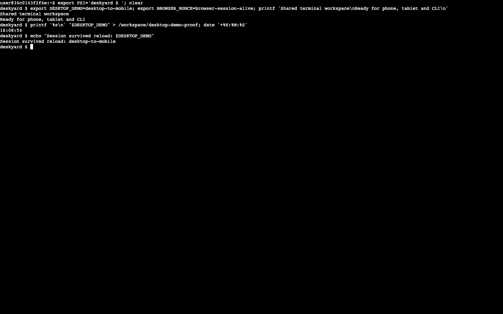

**Superseded on 23 October 2026 by [[superpowers/specs/2026-10-23-shared-terminal-design|Shared terminal design]], implemented with image-owned tmux and the authenticated supervisor terminal. The unchanged-source statements below describe this historical experiment only. Its results and limitations are preserved here.**

A throwaway Zellij 0.45.1 prototype of shared terminal access through the browser, local CLI and XFCE. The three clients attached to the same running Bash session and shared its in-memory environment. This is experimental evidence, not an adopted terminal architecture or a shipped Deskyard feature.

# What is in the prototype

The adjacent [prototype folder](2026-10-23-terminal-access/) contains a small overlay Dockerfile, a separate Zellij configuration and plain layout, a `shared-terminal` helper, an XFCE application entry, a supervisord program, a disposable demo launcher and verification scripts. It derives from an already-built XFCE image; the normal image and supervisor sources are unchanged. The Zellij release is pinned and the extracted Linux binary is verified against its published SHA-256 for arm64 or amd64. Only arm64 was exercised here.

Zellij owns the shell and its PTY. The browser uses Zellij's native web terminal with a Deskyard presentation overlay. A local `deskyard exec --tty -- shared-terminal main` runs a native Zellij client through the existing agent exec WebSocket. XFCE launches the same helper in `xfce4-terminal`. The user's ordinary shell, terminal launcher, Zellij configuration and CLI remotes are not changed.

A separate Caddy instance listens on the desktop's `127.0.0.1:8082` and forwards authentication and WebSockets to Zellij on `127.0.0.1:8083`. The demo uses `deskyard forward -R 8082:LOCAL_PORT` to reach it on host loopback. The terminal has its own origin and Zellij authentication; it loads no Selkies client. This is not integration with Deskyard's web login or toolbar. Do not proxy HTML or JavaScript from a running desktop onto the supervisor's authenticated origin as a shortcut to that integration.

# Deskyard presentation

The visible terminal has no engine status/tab bar, welcome branding or upstream browser icon/title. `terminal-layout.kdl` supplies plain initial and new tabs. The prototype sets `layout_dir` explicitly: without an existing user configuration directory, this release silently fell back to its built-in branded layout even when given an absolute layout path. Keybindings are limited to terminal, pane, tab, scroll and detach controls; branded plugin menus are not bound. Ctrl-g unlocks controls; Ctrl-o then d detaches. Pane mode is Ctrl-p (n creates, x closes, arrows change focus); tab mode is Ctrl-t (n creates, x closes, left/right select); Ctrl-s enters scroll mode. Esc returns to locked input.

`prepare_web.py` downloads only the pinned release's index and application JavaScript, checks their SHA-256 hashes, replaces two visible strings and regenerates the script's SHA-384 integrity value. The Deskyard icon is copied from the existing UI. The manifest, browser title and welcome text use Deskyard Terminal. `terminal.Caddyfile` serves these presentation assets and forwards API calls, cookies and WebSockets without rewriting their contents. It preserves security headers and remains on a separate loopback origin from the supervisor. A normal rebuild fails if the pinned assets change. Caddy explicitly binds to `127.0.0.1`; a site hostname alone does not restrict its listening interface. Independent review caught that distinction, and the actual IPv4/IPv6 listener is now checked by the live presentation test. Technical identifiers and dependency/license attribution remain in source and `THIRD_PARTY_NOTICES.txt`.

The bare web URL redirects to `/main`, avoiding the engine's welcome plugin.

The native client also prints a hard-coded branded goodbye. `terminal_attach.py` gives the client an inner PTY, relays input and window changes, and replaces that final teardown message with “Detached from Deskyard Terminal.” It leaves pane output intact, including identical words printed by shell programs, and preserves the client's exit status. This extra PTY is experimental integration code; it is covered by byte-stream tests and a real CLI attachment/detach check. A live resize check also propagated a 36-row by 110-column host PTY through the CLI and this helper to Bash's `stty size`.

# Running it

Prerequisites: Docker, Go and Node from the normal development setup; an existing local `deskyard-debian-xfce:test` image. Build that image from this checkout first if needed; use the repository [README](../../../README.md) for normal image/build commands.

From the repository root:

```sh
(cd supervisor && make build)
python3 docs/superpowers/spikes/2026-10-23-terminal-access/demo.py --build-image
```

The script prints the terminal URL, desktop URL, path to private login details, and a ready-to-run CLI attachment script. It generates a unique desktop name, random local ports, a random administrator password and a private agent token. Read the `zellij_token` from the mode-0600 `access.json` to authenticate the terminal. The desktop page uses the separate demo administrator credentials from the same file. The CLI attachment script carries its token in environment variables and is mode 0700. Credentials are not saved in this repository or the user's normal CLI configuration. Keep the demo on loopback; remote phone access and HTTPS are not configured.

The demo supervisor has separate account/token state, but it uses the same Docker engine and can discover other Deskyard-managed desktops. Its admin account is therefore not an isolation boundary: use only the generated demo desktop. The runner creates and removes only its generated desktop. Normal supervisor startup reconciliation still runs, so use a dedicated Docker engine if unrelated desktops must not even be inspected. A production terminal does not require a second supervisor.

Press Ctrl-C in the runner to let any in-progress desktop creation settle, stop forwarding, remove the demo desktop and its network, and stop the demo supervisor. Workspace files and logs remain in the private temporary state directory for inspection; the access file and attachment script are removed. Use a new state directory on every run. The overlay image remains available for reruns. A forced kill or machine crash can leave demo resources behind; their generated name and runner PID are recorded in `owner.json` before creation; the creation job ID is added once accepted. To stop a detached demo, send SIGTERM to that recorded runner PID after verifying its command line. Supervisor logs also record creation.

The XFCE Applications menu has **Shared Terminal (prototype)**. The CLI equivalent is:

```sh
deskyard exec --tty -- shared-terminal main
```

Use it with the demo's generated attachment script or the `DESKYARD_URL` and `DESKYARD_TOKEN` from `access.json`. The existing `deskyard shell` behavior is unchanged. Ctrl-g unlocks Zellij's controls; Ctrl-o then d detaches. Closing a connection leaves the workspace running. Container stop/restart still ends live processes; resurrection is disabled in this prototype to avoid implying process checkpointing.

# Verification

```sh
python3 docs/superpowers/spikes/2026-10-23-terminal-access/test_terminal.py
python3 docs/superpowers/spikes/2026-10-23-terminal-access/test_cleanup.py
python3 docs/superpowers/spikes/2026-10-23-terminal-access/test_attach_output.py
```

This uses a disposable container of the overlay image and verifies idempotent background session creation, targeted shell input, state continuity and invalid session-name rejection. It failed against the ordinary desktop image before the helper was added, then passed against the prototype. The test bypasses normal desktop initialization and supplies a writable runtime directory explicitly.

For the live presentation check, run `python3 docs/superpowers/spikes/2026-10-23-terminal-access/test_branding.py /tmp/YOUR-DEMO/access.json`. This checks the served title, icons, manifest, welcome text, script integrity, unauthenticated API rejection and actual loopback-only listening socket.

For the live cross-client check, first enter this in the web terminal:

```sh
export BROWSER_NONCE=browser-session-alive
```

Then, from the repository root, pass the runner's actual access file:

```sh
python3 docs/superpowers/spikes/2026-10-23-terminal-access/verify_live.py /tmp/YOUR-DEMO/access.json
```

The script uses a real host PTY and the normal `deskyard` agent transport, reads the browser-created variable from the existing shell, adds a CLI-created variable and detaches. It launches the installed desktop entry's actual Exec command, checks that another client joined `main`, and verifies the same shell completed a job with both variables intact. It leaves an XFCE terminal open so the result can be inspected.

Observed on macOS arm64 with OrbStack/Docker 29.8.2:

- Static documentation links, referenced paths and page metadata passed checks. SilverBullet runtime rendering was not checked: the registered Container Computer space points at the main checkout rather than this worktree.
- Existing supervisor/server, CLI app and exec WebSocket unit tests passed as a baseline.
- `make build` passed for the existing UI, scanner, supervisor and CLI.
- The new disposable-image test passed. A process-group Ctrl-C regression test failed before child-process isolation was added, then passed. Interruption during desktop creation is also checked: the runner lets creation settle before cleanup.
- Independent review found lifecycle cleanup and overly permissive detach-verification issues; the runner now isolates child process groups, defers interrupts until startup creation settles, and retries busy deletion. The live verifier requires natural successful detach.
- Browser login, Bash input and command output worked in the in-app browser.
- Live CLI-to-browser shell-state sharing, CLI detach, XFCE attachment and job completion passed.
- Browser reload and closing/reopening the browser tab reattached to the existing session; both shell variables remained available. A delayed background job completed while the browser tab was closed. A reconnect briefly showed the upstream reconnect dialog before recovering automatically.
- A phone-width desktop-browser viewport was inspected, but this does not activate Zellij's native mobile interface because the browser still reports a desktop pointer/user agent. With another larger client attached, fit-to-view made text very small; sizing ownership needs explicit design.



# Findings and remaining checks

Zellij needs both a running web server and `web_sharing "on"` for CLI-created sessions to accept authenticated web clients. Without that setting the web UI repeatedly showed “Connection lost”; its control channel identified the actual reason as “This session does not allow web connections.” The prototype sets this explicitly. It also sets Bash explicitly: a headless session otherwise fell back to `/bin/sh` when `SHELL` was absent.

`attach --create-background` fails with “Session already exists” when invoked twice. The helper checks the existing session list before creating. It is sufficient for this single-runner prototype, but concurrent creation can still race; a production helper must handle that case. Headless scripted input needs an explicit terminal pane ID. On this release `web --create-token --token-name NAME` is rejected, so the launcher uses `web --create-token` alone.

Native simulator testing was subsequently completed while the host Mac remained locked. Computer Use could not control the locked host, but unattended XCTest/`xcodebuild` with `simctl`, a headless Android emulator with ADB/Chrome DevTools, and headless desktop Playwright worked. These checks used the actual iOS/iPadOS Safari and Android Chrome engines; phone-sized desktop emulation was not substituted for device tests.

| Client | Observed result | Input coverage |
| --- | --- | --- |
| Desktop Chromium, 1280 × 800 | Login, shell commands, browser reload and persistent shell variable passed; video captured. | Playwright browser keyboard events. |
| iPhone 17 Pro, iOS 26.3.1 Safari | Login, mobile toolbar/menu, shared browser/CLI variables, portrait/landscape/portrait and shell proof-file creation passed. | XCTest native typing after an explicit screen-coordinate focus tap; not a complete software-keyboard test. |
| iPad mini (A17 Pro), iPadOS 26.3.1 Safari | Original engine run passed login, input and rotation. The Deskyard-presentation retake stalled on a blank Safari loading tab; preparation did not reach the terminal, so no updated iPad capture is delivered. | Earlier XCTest native keyboard events; current presentation and broad IME coverage remain open on iPad. |
| Pixel 10 AVD, Android 17 Chrome | Native mobile UI, real Gboard key taps, shared browser/CLI variables, remembered-login reload and mobile menu passed. | ADB screen taps typed `touch b`; the CLI independently checked `/workspace/b`. Browser keyboard events separately checked shared variables. The accessory Ctrl key interrupted a running `sleep` in an earlier check. |

The recorded `studio` session was created in desktop Chromium. A real local PTY then attached through `deskyard exec --tty`, read the browser's in-memory variable, added `CLI_NONCE`, and detached naturally with exit status 0. iPhone Safari and Android Chrome subsequently printed both values. Mobile commands wrote proof files, whose contents were checked independently through the CLI; a passing XCTest result alone was not treated as proof that typing reached Bash. Remember me must be selected for Zellij authentication to survive a browser reload; without it, the token prompt reappears while the shell itself continues running.

Two automation failures are retained as limitations rather than terminal verdicts: XCTest could not synthesize a two-finger tap against Safari's remote web-view hit target, and fast `adb input text` injection dropped or duplicated characters. Real Gboard key taps worked. A plain XCTest `typeText` call without an explicit focus tap also produced no shell command, even though XCTest reported success. iPhone focus could zoom or shift Safari's viewport enough to clip the toolbar; rotation restored the recorded layout. Default desktop text is small, mobile text is much larger, and simultaneous clients can impose awkward dimensions. Input from two clients at the same time interleaves in the one shell; recordings should hand control over sequentially.

Physical phones/tablets, broad IME input, selection, clipboard, touch scrolling, background/suspend recovery and a genuine network loss remain unverified. The simulator work establishes feasibility, not a finished mobile experience.

# Screenshots and recordings

The desktop, Android and iPhone files are refreshed recordings of the Deskyard presentation, replacing the initial engine-branded captures. They are actual browser and simulator recordings of the prototype, not mockups. The desktop capture uses headless Chromium. Android uses emulator `screenrecord`; iPhone/iPad use `simctl recordVideo`. The videos exclude authentication typing and are encoded as H.264 MP4 for preview. Mobile screenshots retain the browser controls and show the sizing behavior described above.

- [Desktop browser video](2026-10-23-terminal-access/media/desktop.mp4) and [screenshot](2026-10-23-terminal-access/media/desktop.png): shell input and reload, before the local CLI/mobile handoff.
- [Android browser video](2026-10-23-terminal-access/media/android.mp4), [software keyboard](2026-10-23-terminal-access/media/android-keyboard.png), [shared shell after reload](2026-10-23-terminal-access/media/android.png) and [mobile menu](2026-10-23-terminal-access/media/android-menu.png).
- [iPhone Safari video](2026-10-23-terminal-access/media/iphone.mp4) and [screenshot](2026-10-23-terminal-access/media/iphone.png) and [software keyboard](2026-10-23-terminal-access/media/iphone-keyboard.png): mobile controls, shared shell state and rotation; software-keyboard gesture coverage is incomplete.
The old iPad recording and screenshots were removed because they showed the upstream icon. A replacement was not captured: Safari remained on a blank loading tab during the retake, and native accessibility targeting also failed during preparation. This is an incomplete retest, not evidence that the presentation overlay works on iPad or that the terminal itself failed.

Before choosing Zellij, resolve Safari focus/viewport behavior and verify single-pane/fit behavior with another large client attached, then compare the same tasks with tmux plus a browser terminal if needed. Also test an editor and a sustained-output workload, a true network interruption, and revocation during live access. Zellij's own token authentication must be integrated with Deskyard's existing session/access checks without leaking supervisor cookies into desktop-served code or leaving independent credentials able to outlive Deskyard access. The prototype preserves Zellij authentication and uses an existing revocable agent forwarding link, but does not solve that product integration.

No production responsibilities, interfaces or component status changed, so the existing [[Architecture/Remote CLI]], [[Architecture/Remote access API]], [[Architecture/Web UI]] and [[Architecture/Desktop]] metadata remain accurate. This spike records experimental wiring separately.

References: [Zellij web client](https://zellij.dev/documentation/web-client.html), [session sharing options](https://zellij.dev/documentation/options.html), [pinned release](https://github.com/zellij-org/zellij/releases/tag/v0.45.1).
