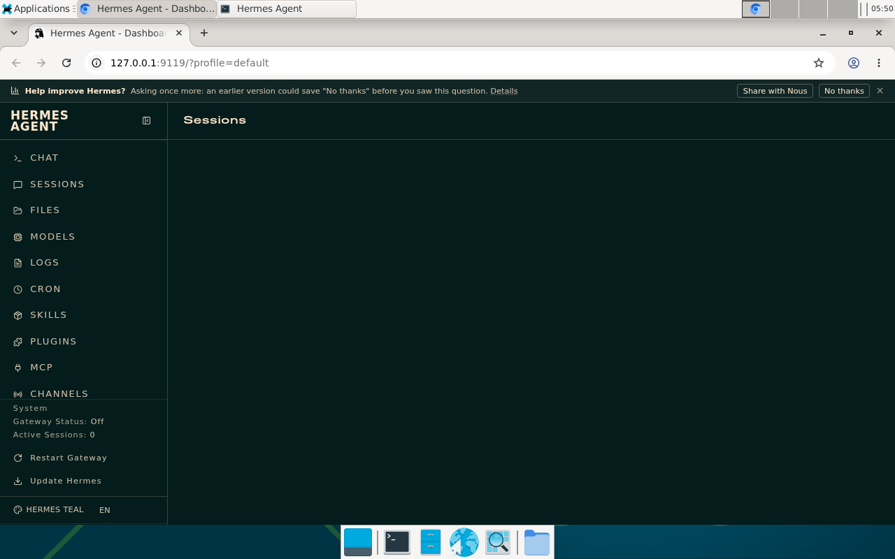

Hermes Agent v0.22.5 installs and starts as the ordinary `user` in a Deskyard XFCE desktop. CLI version reporting, provider selection, the local dashboard and skill discovery were verified before and after a container restart. A real model conversation is pending provider authentication. This is a manual compatibility trial, not a bundled agent or an automated integration test.



# Environment

- macOS with OrbStack, Linux arm64 desktop image `deskyard-debian-xfce:test`, image ID `sha256:573719d7b5e192c51ef0d0117dbd918702a92b293bb0162f6fe94437b9be1608`.
- Separate container `deskyard-hermes-spike`, named home volume `deskyard-hermes-spike-home`, UID/GID 1000, normal image entrypoint, 1 GiB shared memory and the repository's desktop security options. Only the desktop HTTP port is published, on host loopback, with its normal proxy-token requirement. This trial container is not registered with a supervisor and its published port is not a ready-to-open supervisor desktop URL.
- Official installer downloaded from [Nous Research](https://hermes-agent.nousresearch.com/install.sh); it selected stable v0.22.5, commit `bf0203a794a0`. Hermes provisions Python 3.14.9 and its own pinned tools; the image's Python 3.13 and Node 24 are not its application runtime.
- Existing desktops and their credentials were not used. No supervisor code, desktop image source or system packages were changed.

# Install in a desktop terminal

```bash
curl -fsSL https://hermes-agent.nousresearch.com/install.sh -o /tmp/hermes-install.sh
env -u UV_PYTHON_PREFERENCE bash /tmp/hermes-install.sh --non-interactive --skip-browser --skip-computer-use
hermes config set skills.external_dirs '["/opt/workspace/skills"]'
LANG=C.UTF-8 hermes model
LANG=C.UTF-8 hermes
```

The image used for this trial exports `UV_PYTHON_PREFERENCE=only-managed` in `images/Dockerfile`. The unmodified Hermes installer invokes its pinned uv with `--managed-python`, which conflicts with that environment setting: `the argument --managed-python cannot be used with --python-preference`. It stopped at `bootstrap Python lookup failed`. Removing only that variable for the installer made the same managed-Python lookup succeed and the installer complete. The retained trial container still uses that older image. Its installer runs should use the same environment workaround; updater compatibility has not been tested.

The subsequent image fix replaces that environment variable with `python-preference = "only-managed"` in `/etc/uv/uv.toml`. Newly built desktop images retain the persistent Python default while permitting explicit installer flags, user configuration and `UV_NO_CONFIG=1` to take precedence. The workaround above remains relevant to older images. See [[Architecture/Desktop tools]] for the implemented configuration and regression coverage.

Follow-up verification on native ARM64: the new login/non-login installer regression cases both failed on the unchanged image with the original argument conflict. After building `deskyard-debian-xfce:uv-config` from the changed Dockerfile, `AC_IMAGE=deskyard-debian-xfce:uv-config AC_POOL=0 uv run pytest test_persistence.py test_boot.py test_skills.py -m '' -q` in `images/tests/` passed all 22 tests, including network tool installation, persistent interpreter ownership and recreation with a derived image. A clean container refused to use image Python under the system default; a user config selecting `only-system` successfully selected `/opt/runtimes/python/bin/python`. Hermes' exact managed-Python lookup also succeeded with its pinned uv 0.13.5 and `UV_NO_CONFIG=1`, using the retained home read-only and a temporary writable cache. This verifies the bootstrap conflict is fixed without rerunning the full Hermes installer. KDE/MATE and amd64 runtime checks were not repeated for this shared configuration change.

The trial's POSIX locale rendered Unicode poorly in the provider picker; launching it with `LANG=C.UTF-8` supplies an explicit UTF-8 locale. Source, dependencies, managed tools, configuration and launcher live under `/workspace` (`~/.hermes`, `~/.local/share/uv`, and `~/.local/bin/hermes`). The home volume must be retained to keep the installation.

Hermes defaults to `terminal.backend: local`, appropriate for executing inside this container. Do not select its Docker backend unless deliberately configuring an additional engine. The desktop's `libatomic.so.1` already satisfies the managed Node prerequisite; no sudo or apt was needed.

`skills.external_dirs` exposes `/opt/workspace/skills` directly. `hermes skills list --source all` reported `workspace-browser`, `workspace-computer` and `workspace-computer-use` enabled as external skills. Deskyard's startup script does not automatically configure Hermes; this is a per-installation setting. These skill instructions give access to the existing shared browser and `deskyard` CLI; Hermes' native browser/computer-use backends were not validated. See [[Architecture/Desktop tools]].

# Verification and remaining limits

- Installer completed with exit 0. `hermes --version` reported v0.22.5, Git installation, Python 3.14.9 and OpenAI SDK 2.24.0.
- `hermes model` opened the provider picker in an XFCE terminal. No provider was selected and no credentials were entered.
- `hermes dashboard --skip-build --no-open` started the built web interface at container loopback `http://127.0.0.1:9119`; a GET returned HTTP 200. The dashboard was also opened in shared Chromium. No host dashboard port was exposed.
- After `docker restart -t 5 deskyard-hermes-spike`, `desktop-ready`, version reporting and external skill discovery succeeded. The dashboard restarted and again reported ready on port 9119. Processes themselves end on restart and must be relaunched; autostart was not configured.
- `hermes doctor` loaded the runtime, required packages, TLS, SQLite and dashboard successfully, but exited 1. It reported missing provider/tool authentication and upstream npm audit issues (one high issue in the root and web trees; one high and one moderate in the TUI tree), plus optional integrations not installed. It is not a clean doctor result. Its template-based “API key or custom endpoint configured” line does not prove working credentials; no inference request was made.
- Built TUI compilation succeeded, but interactive TUI chat, model inference, tool calls driven by a model, native computer-use, messaging gateways, amd64, KDE/MATE and container recreation/image upgrade were not tested. Restart persistence was tested, not upgrade compatibility.

# Continuing the retained trial

The container and named volume are left available. Open provider setup from a host terminal:

```bash
docker exec -it -u user -e LANG=C.UTF-8 deskyard-hermes-spike bash -lc 'hermes model'
docker exec -it -u user -e LANG=C.UTF-8 deskyard-hermes-spike bash -lc 'hermes'
```

Inside this desktop's Chromium, use `http://127.0.0.1:9119` while the dashboard runs. To relaunch it after a restart:

```bash
docker exec -it -u user -e LANG=C.UTF-8 deskyard-hermes-spike bash -lc 'hermes dashboard --skip-build --no-open'
```

Stop just this trial with `docker stop deskyard-hermes-spike`. Removing the container with `docker rm deskyard-hermes-spike` keeps its named home volume; only remove `deskyard-hermes-spike-home` when its installed software and any subsequently saved credentials/data are no longer needed.

References: [Hermes installation](https://hermes-agent.nousresearch.com/docs/getting-started/installation), [Hermes skills](https://hermes-agent.nousresearch.com/docs/user-guide/features/skills), [[Architecture/Desktop runtime]], [[Architecture/Workspace folder]].

# Landing verification

The required pre-commit `make test` was run from an isolated snapshot of commit `2daa562` plus this task’s changes, using the built `deskyard-debian-xfce:uv-config` image and a separate test subnet. Isolation avoided concurrent README/architecture renames and CLI golden-file edits in the shared checkout. Go vet/race tests, UI type checking and all 42 UI tests, and tagged Docker engine tests passed. The desktop parallel pass reported 100 passed, 3 skipped and one failure (`test_desktop_follows_browser_window`); its serial pass passed one test. The supervisor parallel pass reported 148 passed, 9 Firefox skips and two failures (`test_client_comes_from_the_image_not_the_desktop` and `test_client_additions_in_a_browser`). All three failures reproduced on a comparison image made by reverting only this task’s uv config/environment changes, so they are independent of this fix. The full default suite is not clean; the focused 22-test persistence/boot/skills run described above is clean.

The remaining supervisor serial pass completed separately: 7 passed. While landing, independent commit `2cf85bf` repaired native Selkies behavior and updated the affected screen tests. The broad results above describe the isolated pre-repair baseline; they are not a claim that the full suite was rerun on that subsequent commit.
